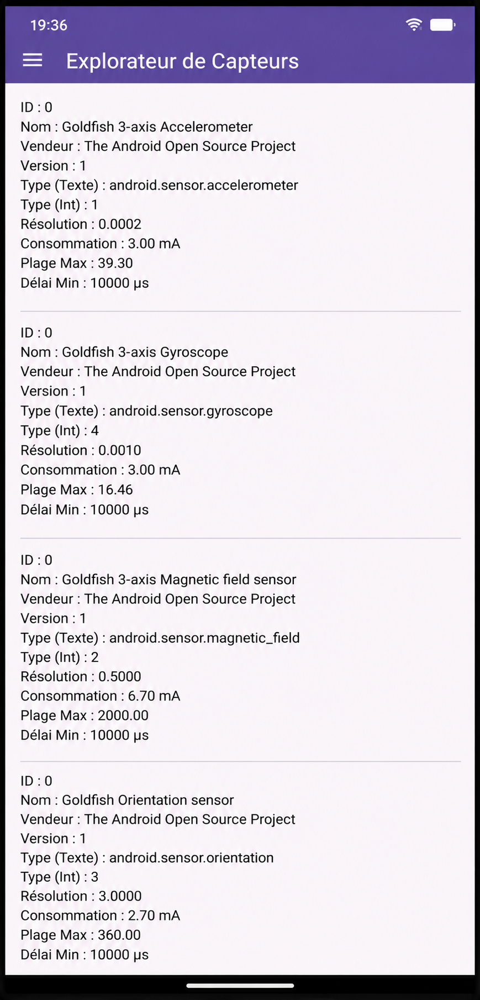
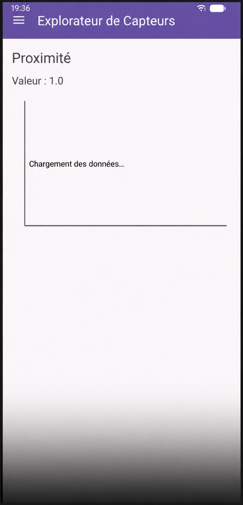
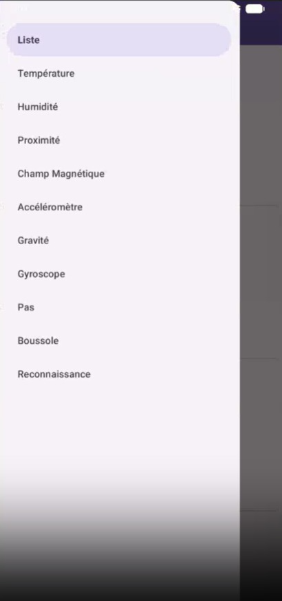

# Lab 21 — Capteurs embarqués Android

> **Cours :** Programmation Mobile — Android avec Java

---

##  Description

**Explorateur de Capteurs** est une application Android qui exploite le **framework de capteurs** d'Android pour lire, afficher et analyser en temps réel les données des capteurs embarqués du téléphone : accéléromètre, gyroscope, champ magnétique, proximité, température, humidité, et bien d'autres.

L'objectif est de comprendre le rôle de chaque capteur, de visualiser ses données sous forme de graphe, et d'implémenter des fonctionnalités avancées comme une boussole numérique, un compteur de pas ou une reconnaissance simple d'activité.

---

##  Aperçu de l'application

### Écran 1 — Liste des capteurs disponibles





> _Liste des capteurs détectés sur le device : accéléromètre, gyroscope, champ magnétique, orientation — avec nom, vendeur, type, résolution, consommation et plage max._

---

### Écran 2 — Mesure en temps réel (ex : Proximité)





> _Affichage de la valeur en temps réel du capteur de proximité avec graphe de mesures._

---

### Écran 3 — Menu de navigation (tiroir latéral)





> _Tiroir de navigation latéral listant tous les écrans disponibles : Liste, Température, Humidité, Proximité, Champ Magnétique, Accéléromètre, Gravité, Gyroscope, Pas, Boussole, Reconnaissance._

---

##  Objectifs pédagogiques

- Découvrir le **SensorManager** et l'API de capteurs Android
- Lister tous les capteurs disponibles sur un appareil
- S'abonner aux événements capteurs via `SensorEventListener`
- Afficher les données sous forme de **graphe dynamique**
- Implémenter des capteurs composites : boussole, compteur de pas
- Gérer le **cycle de vie** des listeners (enregistrement / désenregistrement)
- Optimiser la **consommation d'énergie** selon la fréquence d'échantillonnage

---

##  Architecture du projet

```
com.example.capteurs/
├── MainActivity.java              # Activité principale (navigation)
├── sensors/
│   ├── SensorListFragment.java    # Partie 2 — Liste des capteurs
│   ├── SensorGraphFragment.java   # Partie 3 — Graphe de mesures
│   ├── EnvSensorFragment.java     # Partie 4 — Temp., humidité, proximité, magnétique
│   ├── MotionSensorFragment.java  # Partie 5 — Accéléromètre, gravité, gyroscope
│   ├── StepCounterFragment.java   # Partie 6 — Compteur de pas & énergie
│   ├── CompassFragment.java       # Partie 7 — Boussole numérique
│   └── ActivityFragment.java     # Partie 8 — Reconnaissance d'activité
└── utils/
    └── GraphView.java             # Vue personnalisée pour le graphe
```

---

##  Parties du Lab

| # | Partie | Capteurs concernés |
|---|--------|--------------------|
| 1 | Préparation du projet | — |
| 2 | Affichage des capteurs disponibles | Tous (`SensorManager.getSensorList`) |
| 3 | Création d'un graphe simple | Accéléromètre |
| 4 | Température, humidité, proximité, champ magnétique | `TYPE_AMBIENT_TEMPERATURE`, `TYPE_RELATIVE_HUMIDITY`, `TYPE_PROXIMITY`, `TYPE_MAGNETIC_FIELD` |
| 5 | Accéléromètre, gravité et gyroscope | `TYPE_ACCELEROMETER`, `TYPE_GRAVITY`, `TYPE_GYROSCOPE` |
| 6 | Compteur de pas et économie d'énergie | `TYPE_STEP_COUNTER`, `TYPE_STEP_DETECTOR` |
| 7 | Boussole numérique | `TYPE_MAGNETIC_FIELD` + `TYPE_ACCELEROMETER` |
| 8 | Reconnaissance simple d'activité | Fusion de capteurs |

---

##  Fonctionnalités

- ✅ Liste complète des capteurs du device (nom, vendeur, type, résolution, consommation)
- ✅ Lecture en temps réel avec `SensorEventListener`
- ✅ Graphe dynamique des mesures
- ✅ Capteurs environnementaux (température, humidité, proximité)
- ✅ Capteurs de mouvement (accéléromètre, gyroscope, gravité)
- ✅ Compteur de pas avec gestion de l'énergie
- ✅ Boussole numérique (orientation calculée par fusion)
- ✅ Reconnaissance d'activité simple

---

##  Dépendances (build.gradle)

```groovy
// Graphe (optionnel, selon implémentation)
implementation "com.github.PhilJay:MPAndroidChart:v3.1.0"

// RecyclerView
implementation "androidx.recyclerview:recyclerview:1.3.2"
```

> Aucune permission spéciale n'est requise pour les capteurs matériels. Le `SensorManager` est accessible directement via `getSystemService(Context.SENSOR_SERVICE)`.

---

##  Installation & lancement

1. Cloner le dépôt :
   ```bash
   git clone https://github.com/<votre-utilisateur>/<votre-repo>.git
   ```
2. Ouvrir le projet dans **Android Studio**.
3. Synchroniser Gradle (`Sync Now`).
4. Lancer sur un **appareil physique** pour des capteurs réels, ou sur un émulateur (capteurs simulés disponibles via le panneau *Virtual sensors*).

---

##  Points importants

> **Cycle de vie :** toujours enregistrer le listener dans `onResume()` et le désenregistrer dans `onPause()` pour éviter de consommer de la batterie inutilement en arrière-plan.

> **Émulateur :** les capteurs physiques (température, humidité, proximité) peuvent être simulés via **Android Studio → Emulator → Extended Controls → Virtual sensors**.

> **Fréquence d'échantillonnage :** utiliser `SENSOR_DELAY_NORMAL` pour la plupart des cas ; réserver `SENSOR_DELAY_FASTEST` uniquement quand c'est nécessaire pour économiser la batterie.

> **Boussole :** la fusion accéléromètre + magnétomètre via `SensorManager.getRotationMatrix()` et `getOrientation()` est plus fiable que le capteur `TYPE_ORIENTATION` (déprécié).

---

##  Auteur

- **Nom :**HMAMI Mohamed
- **Cours :** Programmation Mobile — Android avec Java

