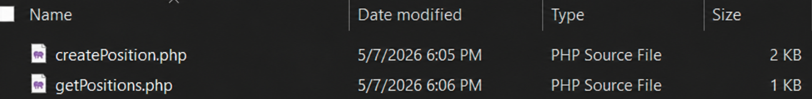
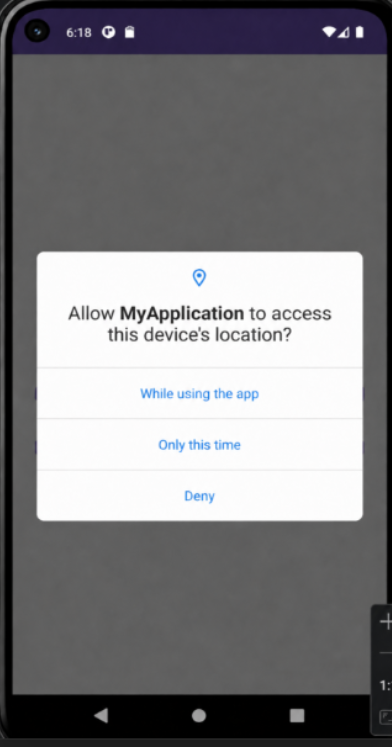
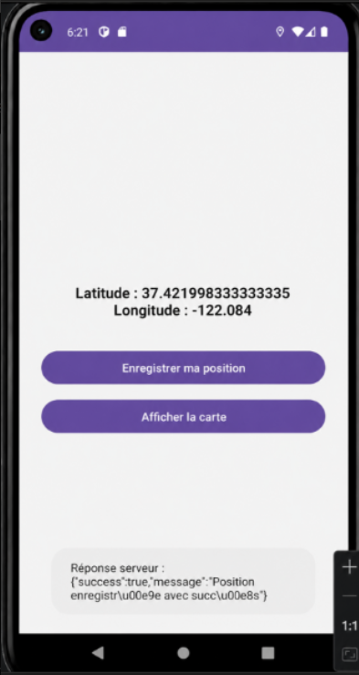
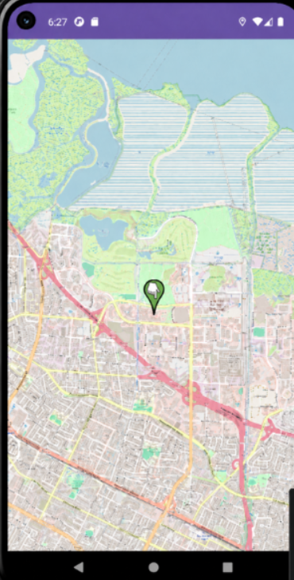
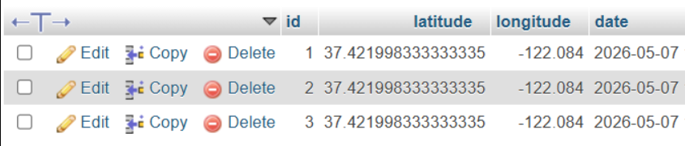
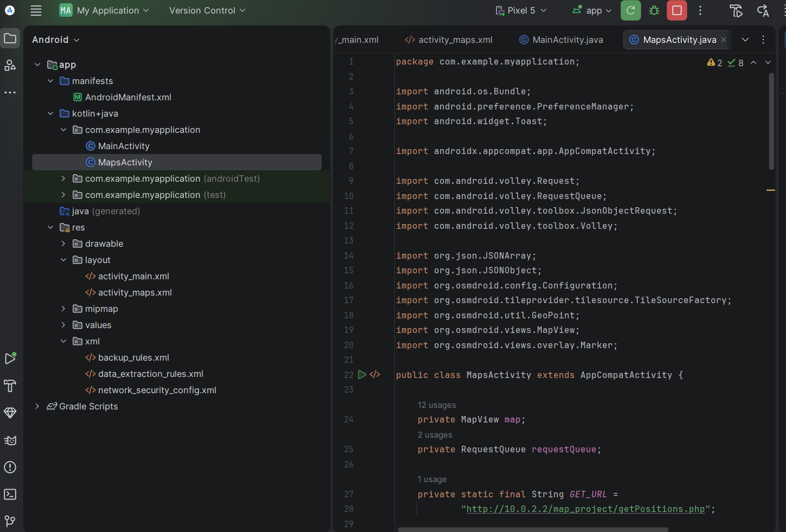
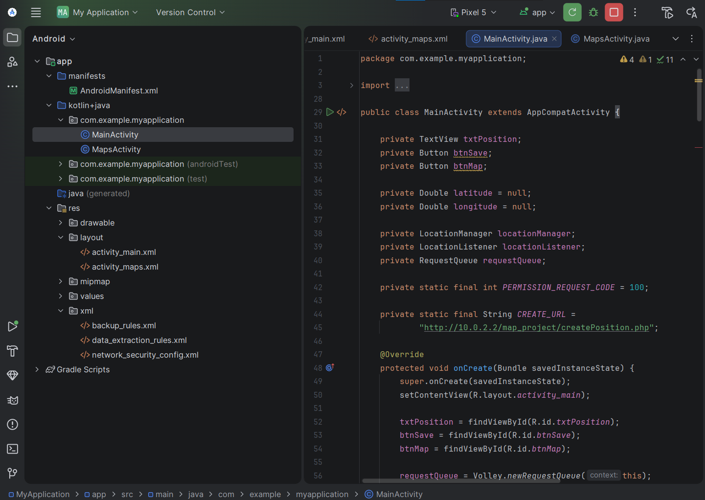

# Application Android de Suivi GPS avec Backend Local

## Présentation générale

Ce projet est une application mobile Android permettant de capturer la position géographique d’un utilisateur, de l’envoyer vers un serveur local, puis de l’afficher sur une carte interactive.

Le fonctionnement repose sur une communication simple entre trois parties :

Android récupère la position GPS, PHP reçoit les données, MySQL les stocke, puis l’application affiche les coordonnées enregistrées sur une carte OpenStreetMap.

---

# Démonstration du projet

## 1. Fichiers PHP du backend

Le backend du projet est placé dans le dossier `htdocs` de XAMPP.

Il contient deux fichiers essentiels :

- `createPosition.php` : responsable de l’ajout d’une nouvelle position dans la base de données.
- `getPositions.php` : responsable de la récupération des positions déjà enregistrées.

Coller ici la capture du dossier contenant les deux fichiers PHP :

Cette étape montre que le serveur local est bien préparé pour recevoir et retourner les données GPS.

---

## 2. Autorisation d’accès à la localisation

Au lancement de l’application, Android affiche une fenêtre de permission demandant l’accès à la position de l’appareil.

L’utilisateur doit accepter cette permission afin que l’application puisse récupérer la latitude et la longitude.

Cette autorisation est indispensable, car sans elle l’application ne peut pas utiliser les services de localisation.

---

## 3. Écran principal de l’application

Une fois la permission accordée, l’application affiche l’interface principale.

Cette interface contient les coordonnées détectées :

- latitude ;
- longitude.

Elle contient aussi deux boutons :

- `Enregistrer ma position`
- `Afficher la carte`

Dans cet écran, on remarque que l’application a bien récupéré une position depuis l’émulateur Android.

La latitude affichée est :

37.42199833333335

La longitude affichée est :

-122.084

---

## 4. Affichage sur la carte

Après l’enregistrement de la position, l’utilisateur peut cliquer sur le bouton `Afficher la carte`.

L’application ouvre une nouvelle interface contenant une carte OpenStreetMap.

Un marqueur apparaît sur la position récupérée et enregistrée.

Cette capture prouve que les données enregistrées dans la base sont correctement récupérées puis affichées sur la carte.

---

## 5. Vérification dans phpMyAdmin

Les positions envoyées depuis l’application sont stockées dans la table MySQL.

La table contient plusieurs lignes, chacune représentant une position enregistrée.

On observe que les colonnes principales sont :

- `id`
- `latitude`
- `longitude`
- `date`

Chaque clic sur le bouton d’enregistrement ajoute une nouvelle ligne dans la table.

---

# Architecture de fonctionnement

Le projet suit le principe suivant :

Android récupère la localisation de l’utilisateur.

Ensuite, l’application envoie les coordonnées au serveur local à l’aide d’une requête HTTP.

Le fichier PHP reçoit ces données et les insère dans la base MySQL.

Lors de l’ouverture de la carte, l’application interroge un autre fichier PHP afin de récupérer les positions stockées.

Enfin, les positions sont affichées sous forme de marqueurs sur OpenStreetMap.

Schéma logique :

Android App  
→ Récupération GPS  
→ Envoi vers PHP  
→ Stockage MySQL  
→ Lecture depuis PHP  
→ Affichage sur carte  

---

# Organisation des fichiers

## Partie Android

Les fichiers Android principaux sont :

- `MainActivity.java`
- `MapsActivity.java`
- `activity_main.xml`
- `activity_maps.xml`
- `AndroidManifest.xml`
- `network_security_config.xml`

`MainActivity.java` gère la récupération GPS et l’envoi de la position au serveur.

`MapsActivity.java` gère l’affichage de la carte et des marqueurs.

`AndroidManifest.xml` contient les permissions nécessaires, notamment la permission Internet et la permission de localisation.

`network_security_config.xml` autorise la communication avec le serveur local.

---

## Partie serveur local

Les fichiers du serveur local sont :

- `createPosition.php`
- `getPositions.php`

Le premier fichier reçoit les données envoyées par Android.

Le deuxième fichier retourne les données enregistrées sous forme JSON.

Ces fichiers sont placés dans :

C:\xampp\htdocs\map_project

---

# Base de données utilisée

La base de données utilisée pour ce projet est :

map_project

La table principale est :

positions

Elle permet de sauvegarder les informations suivantes :

- identifiant de la position ;
- latitude ;
- longitude ;
- date d’enregistrement.

Exemple de structure logique :

id : numéro automatique  
latitude : coordonnée GPS verticale  
longitude : coordonnée GPS horizontale  
date : moment d’enregistrement  

---

# Fonctionnalités réalisées

L’application permet de réaliser les actions suivantes :

1. Demander l’autorisation GPS à l’utilisateur.
2. Récupérer automatiquement la latitude et la longitude.
3. Afficher les coordonnées sur l’écran principal.
4. Envoyer les coordonnées vers le backend PHP.
5. Enregistrer les données dans MySQL.
6. Vérifier les données avec phpMyAdmin.
7. Afficher les positions sur une carte.
8. Visualiser un marqueur correspondant à la position enregistrée.

---

# Tests effectués

## Test de récupération GPS

La position est correctement affichée dans l’application Android.

Résultat obtenu :

Latitude : 37.42199833333335  
Longitude : -122.084

## Test d’enregistrement

Après le clic sur le bouton `Enregistrer ma position`, les données sont envoyées au fichier PHP.

Le serveur retourne une réponse confirmant le succès de l’opération.

## Test base de données

Les données apparaissent correctement dans phpMyAdmin.

Plusieurs lignes sont ajoutées dans la table `positions`.

## Test carte

La carte OpenStreetMap s’affiche correctement.

Le marqueur apparaît sur la position enregistrée.

---

# Résultat final

Le projet est fonctionnel.

L’application arrive à récupérer la position GPS, à l’envoyer vers le serveur local, à sauvegarder les données dans MySQL et à afficher le résultat sur une carte.

Les captures montrent clairement les différentes étapes du fonctionnement :

- préparation des fichiers PHP ;
- demande de permission GPS ;
- affichage des coordonnées ;
- affichage de la carte ;
- vérification des données dans phpMyAdmin.

---

# Conclusion

Ce lab m’a permis de mettre en pratique la communication entre une application Android et un serveur local.

Il m’a aussi permis de comprendre comment utiliser la localisation GPS, envoyer des données vers PHP, manipuler une base MySQL et afficher des positions sur une carte OpenStreetMap.

Le résultat obtenu confirme que l’ensemble du système fonctionne correctement, depuis l’application Android jusqu’à la base de données et l’affichage cartographique.

