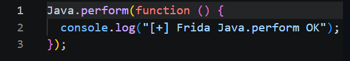
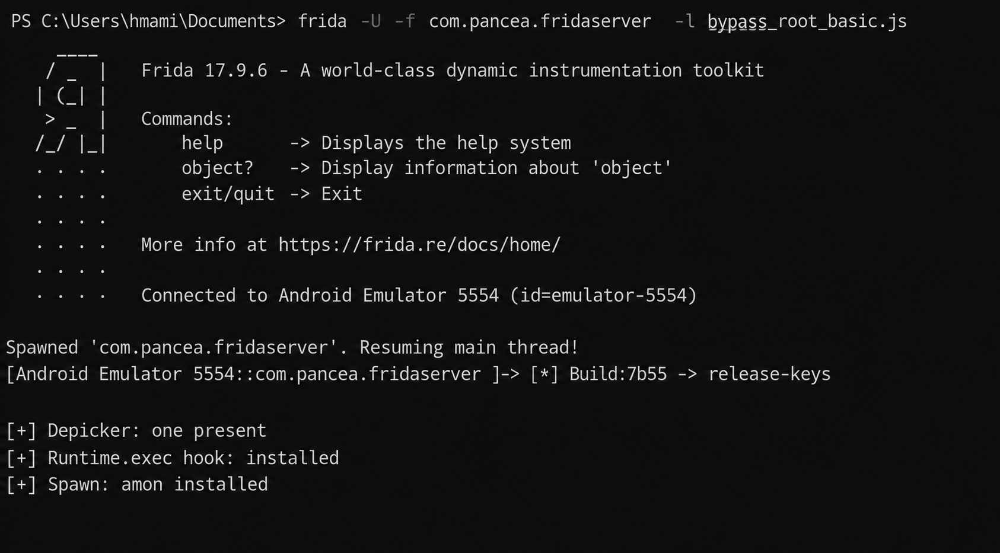
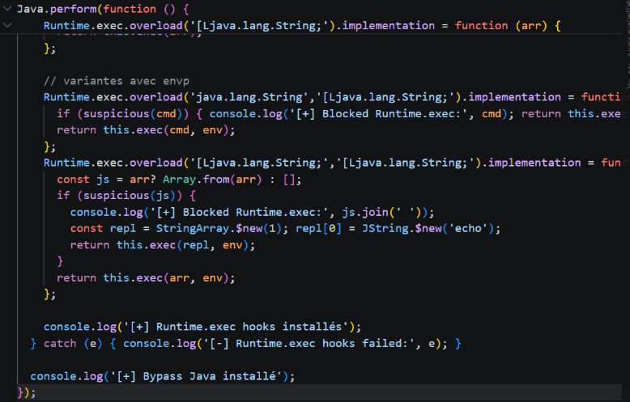
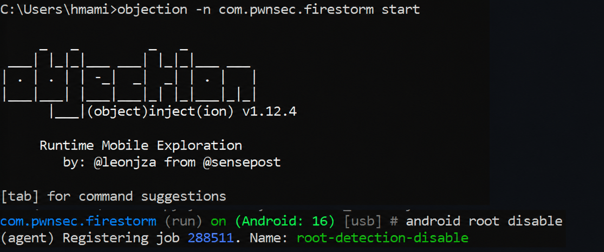
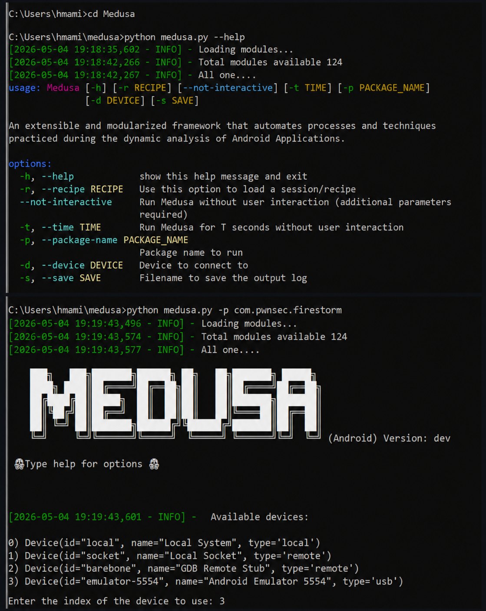
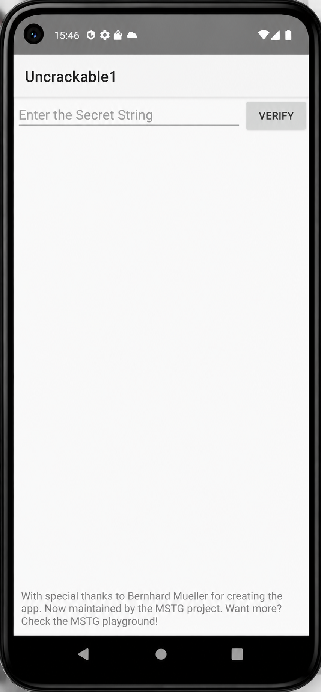

# LAB 14 — Bypass Root Detection sur Android avec Frida, Objection et Medusa


---

## 1. Objectif du lab

Ce lab a pour objectif de comprendre les techniques dynamiques utilisées pour analyser une application Android dans un environnement de test contrôlé.

L’objectif principal est d’étudier le fonctionnement d’une application Android protégée contre la détection root, puis de tester différents outils d’analyse dynamique comme **Frida**, **Objection** et **Medusa**.

>  Ce travail est réalisé uniquement dans un cadre pédagogique, sur une application de laboratoire et dans un environnement autorisé.

---

## 2. Outils utilisés

Les outils utilisés dans ce lab sont :

- Windows CMD / PowerShell
- Android Studio Emulator
- ADB
- Python
- Pip
- Frida
- Frida Server
- Objection
- Medusa
- Script JavaScript de hook

---

## 3. Préparation de l’environnement

La première étape consiste à vérifier que Python, Pip et Frida sont bien installés sur la machine.

Commandes utilisées :

```powershell
python --version
pip --version
frida --version
```

Ensuite, on vérifie que l’émulateur Android est bien détecté avec ADB :

```powershell
adb devices
```

L’émulateur détecté est :

```text
emulator-5554
```

On vérifie aussi l’architecture CPU de l’émulateur :

```powershell
adb shell getprop ro.product.cpu.abi
```

Résultat obtenu :

```text
x86_64
```

Après cela, le fichier `frida-server` est envoyé dans l’émulateur Android :

```powershell
adb push frida-server /data/local/tmp/
adb shell chmod 755 /data/local/tmp/frida-server
adb shell "/data/local/tmp/frida-server -l 0.0.0.0"
```

### Capture 1 — Préparation de Frida Server avec ADB





---

## 4. Lancement de l’application Android

L’application de test utilisée dans ce lab est une application Android appelée **Uncrackable1**.

L’interface contient un champ de saisie permettant d’entrer une chaîne secrète, ainsi qu’un bouton **VERIFY**.

Cette étape permet de vérifier que l’application fonctionne correctement dans l’émulateur avant de commencer l’analyse dynamique.

### Capture 2 — Application Android de test


## 5. Injection avec Frida

Frida est utilisé pour lancer l’application Android et injecter un script JavaScript au moment de l’exécution.

Commande utilisée :

```powershell
frida -U -f com.pwnsec.firestorm -l bypass_root_basic.js
```

Explication de la commande :

- `frida` : lance l’outil Frida ;
- `-U` : indique que l’on utilise un appareil Android connecté ou un émulateur ;
- `-f com.pwnsec.firestorm` : lance l’application ciblée ;
- `-l bypass_root_basic.js` : charge le script JavaScript utilisé pour l’analyse dynamique.

Après l’exécution, Frida se connecte à l’émulateur Android et affiche les messages confirmant que les hooks Java sont installés.

### Capture 3 — Injection du script Frida





---

## 6. Script JavaScript utilisé

Le script JavaScript utilisé avec Frida permet d’interagir avec la couche Java de l’application Android.

Exemple de script :

```javascript
Java.perform(function () {
    console.log("[+] Frida Java.perform OK");
});
```

Ce code permet de vérifier que Frida est bien attaché à l’application et que l’environnement Java est accessible.

Dans le lab, le script sert aussi à intercepter certaines fonctions appelées par l’application pendant son exécution.

### Capture 4 — Script JavaScript Frida




---

## 7. Utilisation d’Objection

Objection est un outil basé sur Frida. Il permet de simplifier certaines tâches d’analyse dynamique grâce à une interface interactive.

Commande utilisée :

```powershell
objection -n com.pwnsec.firestorm start
```

Après le lancement, Objection se connecte à l’application Android et affiche son interface interactive.

Une commande de test utilisée dans le lab est :

```text
android root disable
```

Cette commande permet de tester le comportement de l’application face aux mécanismes de détection root dans un environnement de laboratoire.

### Capture 5 — Utilisation d’Objection





## 8. Utilisation de Medusa

Medusa est un framework modulaire utilisé pour l’analyse dynamique des applications Android.

On commence par accéder au dossier Medusa :

```powershell
cd Medusa
```

Puis on affiche l’aide de l’outil :

```powershell
python medusa.py --help
```

Ensuite, on lance Medusa sur l’application cible :

```powershell
python medusa.py -p com.pwnsec.firestorm
```

Medusa affiche ensuite la liste des périphériques disponibles :

```text
0) local
1) socket
2) barebone
3) emulator-5554
```

L’émulateur Android utilisé dans ce lab est sélectionné avec l’index :

```text
3
```

### Capture 6 — Lancement de Medusa








## 9. Résultat du lab

À la fin du lab, les étapes suivantes ont été réalisées avec succès :

- vérification de l’environnement Python, Pip et Frida ;
- connexion de l’émulateur Android avec ADB ;
- transfert et lancement de `frida-server` dans l’émulateur ;
- lancement de l’application Android de test ;
- injection d’un script JavaScript avec Frida ;
- utilisation d’Objection pour l’analyse dynamique ;
- utilisation de Medusa comme framework complémentaire.

Ce lab permet de mieux comprendre comment les outils d’instrumentation dynamique peuvent être utilisés pour analyser le comportement d’une application Android dans un cadre pédagogique.

---

## 10. Conclusion

Ce lab m’a permis de comprendre le rôle de plusieurs outils importants en sécurité mobile Android.

**Frida** permet d’injecter dynamiquement du code dans une application en cours d’exécution.

**Objection** facilite l’utilisation de Frida grâce à des commandes interactives prêtes à l’emploi.

**Medusa** propose une approche modulaire pour automatiser certaines tâches d’analyse dynamique.

Grâce à ce lab, j’ai pu mieux comprendre les bases de l’analyse dynamique Android, la connexion entre l’ordinateur et l’émulateur, ainsi que l’utilisation de scripts pour observer ou modifier le comportement d’une application dans un environnement contrôlé.

---


---

