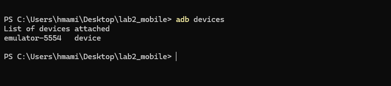
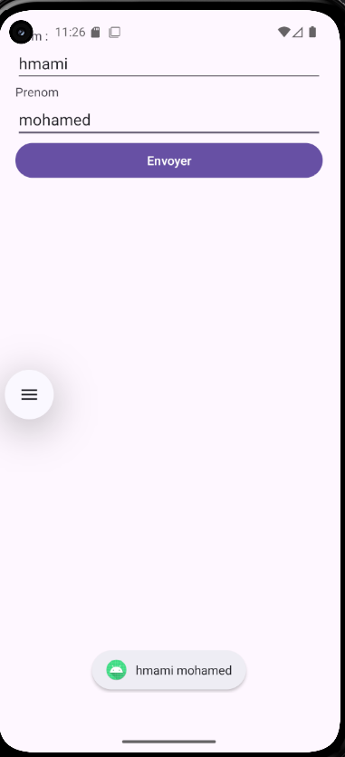
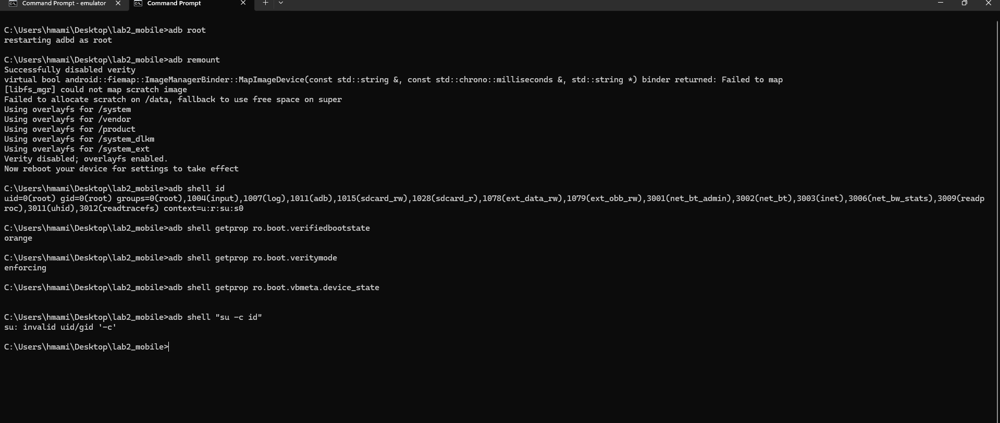
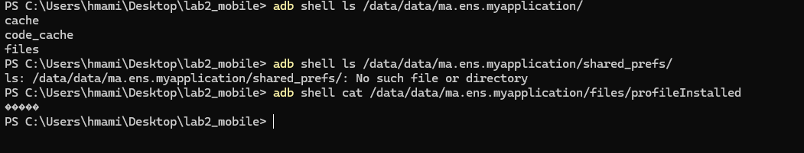
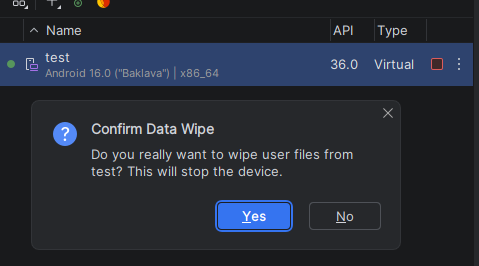
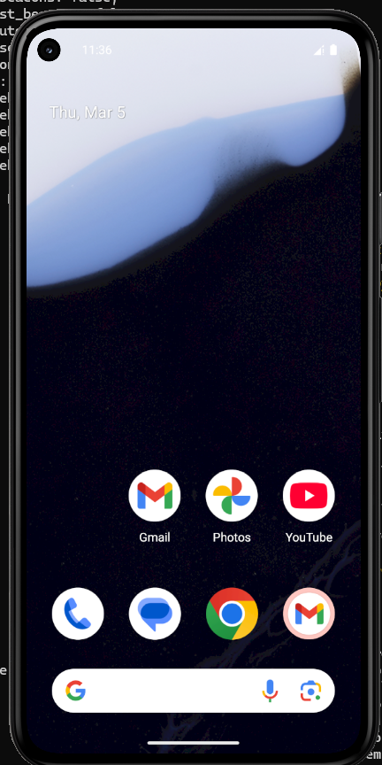

# 🔓 LAB 2 : Rooting Android — Analyse d'impact

## 🎯 Objectif

Ce lab explore les implications concrètes du **rooting Android** dans un contexte de sécurité mobile :

- Vérifier les modifications système induites par le root
- Tracer les actions et observer le comportement du système
- Tester une application dans un environnement rooté
- Analyser les risques selon le référentiel **OWASP MASTG**
- Remettre l'environnement à zéro après les tests

---

## 🗂️ Périmètre

| Champ | Valeur |
|-------|--------|
| Application | `ma.ens.myapplication` v1.0 |
| Support | AVD — `test` (Pixel 6) |
| Android | API 36 (Android 16 / Baklava) |
| Données | Fictives uniquement (`hmami` / `mohamed`) |
| Réseau | Isolé |

---

## 🖥️ Environnement

**Lancement de l'émulateur avec système fichier accessible en écriture :**

```bash
emulator -avd test -writable-system
```

**Vérification de l'AVD connecté :**

```bash
adb devices
```


```
List of devices attached
emulator-5554    device
```

**Version Android :**

```bash
adb shell getprop ro.build.version.release   # → 16
adb shell getprop ro.build.vendor.sdk        # → 36
```

---

## 🔧 Procédure de rooting

Activation du mode root et remontage des partitions système :

```bash
adb root
adb remount
```

**Résultat :**

```
restarting adbd as root
Successfully disabled verity
Using overlayfs for /system
Using overlayfs for /vendor
Using overlayfs for /product
Using overlayfs for /system_dlkm
Using overlayfs for /system_ext
Verity disabled; overlayfs enabled.
Now reboot your device for settings to take effect
```

---

## ✅ Vérifications post-root

| Commande | Résultat | Interprétation |
|----------|----------|----------------|
| `adb shell id` | `uid=0(root)` | ✅ Root actif |
| `adb shell getprop ro.boot.verifiedbootstate` | `orange` | 🔶 Bootloader déverrouillé |
| `adb shell getprop ro.boot.veritymode` | `enforcing` | ℹ️ Mode configuration |
| `adb shell getprop ro.boot.vbmeta.device_state` | *(vide)* | ℹ️ Normal sur AOSP |
| `adb shell "su -c id"` | Erreur | ℹ️ Déjà root, `su` non nécessaire |


---

## 📦 Application testée

```bash
# Installation
adb install app-debug.apk

# Vérification
adb shell pm list packages -3
# → package:ma.ens.myapplication
```

---

## 🧪 Scénarios de test

| # | Scénario | Résultat |
|---|----------|----------|
| 1 | Affichage du formulaire (Nom / Prénom) | ✅ OK |
| 2 | Saisie des données fictives (`hmami` / `mohamed`) + validation | ✅ OK |
| 3 | Notification affichant `hmami mohamed` | ✅ OK |



---

## 🔐 Impact sécurité

### Verified Boot

```bash
adb shell getprop ro.boot.verifiedbootstate
# → orange
```


**Codes couleur Verified Boot :**

| Couleur | Signification |
|---------|---------------|
| 🟢 **Green** | Système intègre et vérifié |
| 🟡 **Orange** | Système modifié mais fonctionnel |
| 🔴 **Red** | Système compromis, démarrage dangereux |

> ⚠️ L'état `orange` indique que l'intégrité du système n'est plus garantie — comportement **attendu** après rooting.

### Android Verified Boot (AVB) 2.0

AVB 2.0 apporte :
- Une **vérification cryptographique** de chaque partition au démarrage
- Une **protection anti-rollback** empêchant l'installation d'anciennes versions vulnérables

---

## 🛡️ Tests OWASP MASTG

### Test 1 — Stockage local (STORAGE-1)

```bash
# Explorer les données de l'application
adb shell ls /data/data/ma.ens.myapplication/
# → cache  code_cache  files

# Vérifier shared_prefs
adb shell ls /data/data/ma.ens.myapplication/shared_prefs/
# → ls: No such file or directory

# Lire le fichier stocké
adb shell cat /data/data/ma.ens.myapplication/files/profileInstalled
# → Données binaires/sérialisées (non lisibles en clair)
```



---

## 🔄 Remise à zéro

**Méthode** : Android Studio → Device Manager → `test` → **Wipe Data**




> Après redémarrage, l'AVD affiche l'écran d'accueil initial — toutes les données utilisateur sont effacées.





---


<div align="center">
  <sub>LAB réalisé dans un environnement isolé à des fins pédagogiques uniquement.</sub>
</div>

