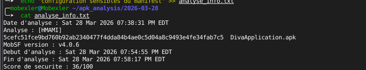
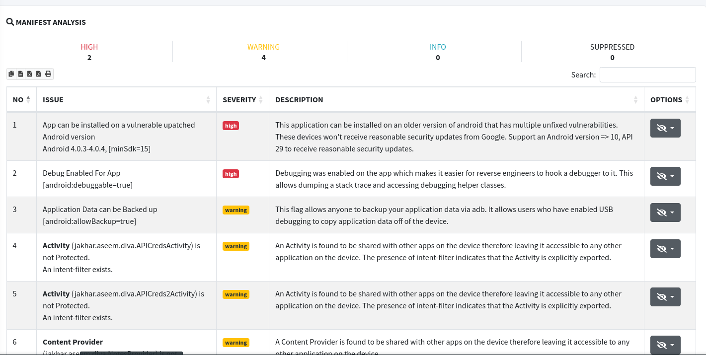
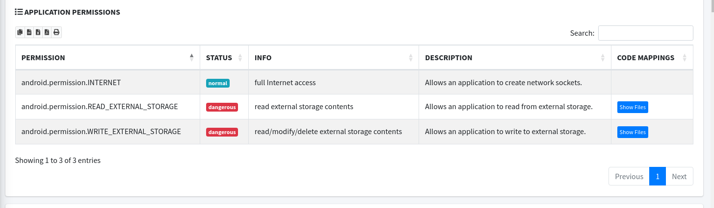
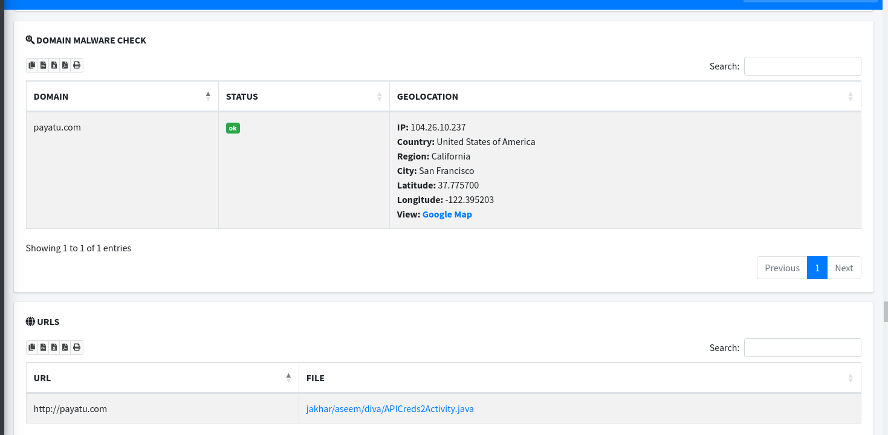
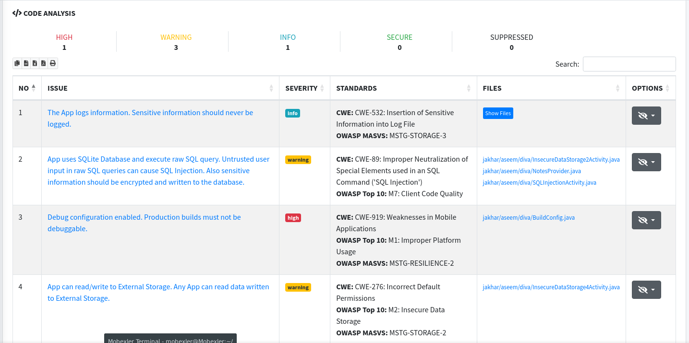
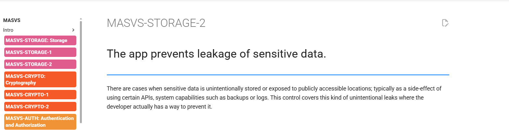
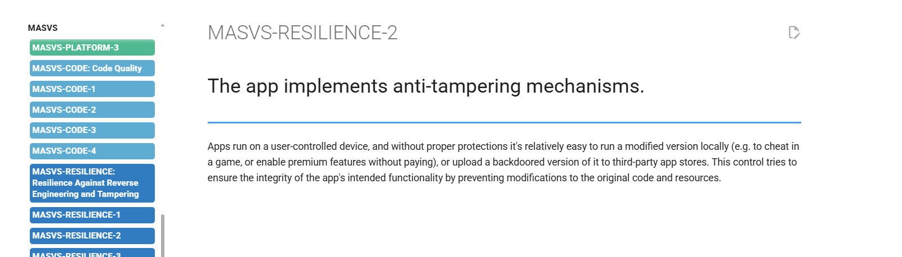
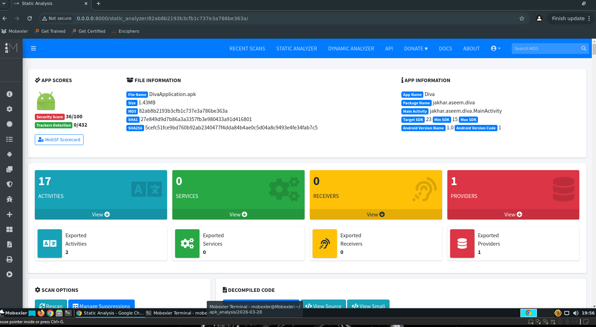
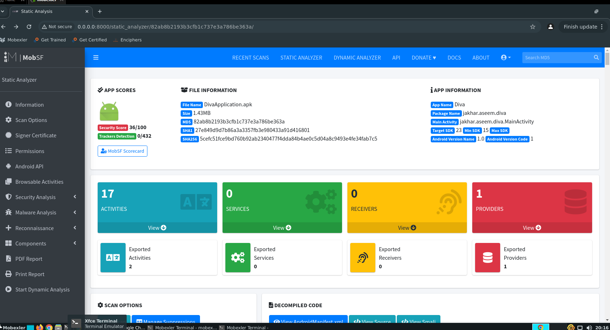
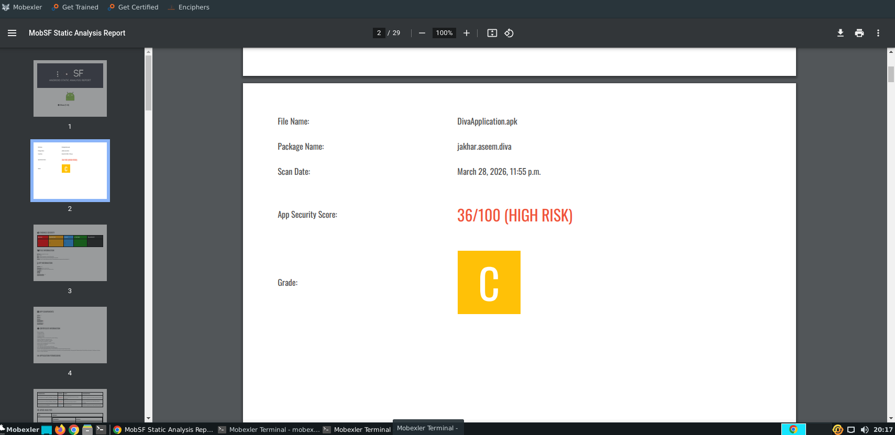

# 📱 Audit de Sécurité Mobile Approfondi : DivaApplication.apk

Ce dépôt présente un projet complet d'audit de sécurité statique réalisé sur l'application **DIVA** (Damn Insecure and Vulnerable Application). Ce lab simule une expertise de cybersécurité réelle, allant de la préparation de l'environnement à la corrélation avec les standards internationaux **OWASP**.

---

## 🛠️ Stack Technique & Méthodologie
* **VM de Pentest :** Mobexler (Basée sur Ubuntu, optimisée pour l'analyse Android/iOS).
* **Outil Automatisé :** [MobSF](https://mobsf.github.io/Mobile-Security-Framework-MobSF/) (Mobile Security Framework) v4.0.6.
* **Analyse Manuelle :** Exploration du code Java décompilé et du Manifeste XML.
* **Référentiel de Conformité :** OWASP MASVS (Mobile Application Security Verification Standard).

---

## 🚀 Phases du Projet & Analyse Détaillée

### 1. Préparation, Intégrité et Traçabilité
Avant de lancer l'analyse, une phase de préparation est indispensable pour garantir la validité des résultats. J'ai généré un fichier de logs (`analyse_info.txt`) qui récapitule l'intégralité du workflow : du calcul du hash SHA-256 à l'obtention du score final.

*Cette capture montre le suivi rigoureux de l'audit : identité de l'analyste, hash de l'APK, durée de l'analyse (4 minutes) et score final de 36/100.*

---

### 2. Analyse Critique du Manifeste (AndroidManifest.xml)
Le manifeste est la "carte d'identité" de l'application. Son analyse a révélé des failles de configuration majeures.

* **Mode Debugging (`android:debuggable=true`)** : Une faille **CRITIQUE**. Elle permet à un attaquant de lier un débogueur (JDWP) à l'application en cours d'exécution pour lire la mémoire vive et extraire des secrets en temps réel.
* **Backup de données (`android:allowBackup=true`)** : Permet à n'importe qui ayant un accès physique au téléphone de copier l'intégralité des données de l'application via `adb backup`.

*Capture montrant les alertes HIGH (Rouge) générées par MobSF sur la configuration du manifeste.*

---

### 3. Gestion des Permissions & Surface d'Attaque
L'application demande des permissions "Dangerous". J'ai analysé la pertinence de ces droits par rapport aux fonctionnalités de l'app.

* **Stockage Externe (`READ/WRITE_EXTERNAL_STORAGE`)** : L'application écrit des données sur la carte SD. Ces données sont alors lisibles par **toutes les autres applications** du téléphone, créant un risque de fuite d'informations massives.

---

### 4. Sécurité des Communications (Réseau)
L'absence de `Network Security Configuration` est un signal d'alarme. L'application autorise par défaut le trafic en clair (**HTTP**).

* **Endpoint Vulnérable** : J'ai identifié l'URL `http://payatu.com` hardcodée dans le code. Sans chiffrement TLS/SSL, un attaquant sur le même réseau Wi-Fi peut intercepter les identifiants envoyés par l'utilisateur via une attaque Man-in-the-Middle (MitM).

*Capture montrant l'extraction automatique des URLs vulnérables par MobSF.*

---

### 5. Analyse du Code Source : Injections & Logs
En explorant la section **Code Analysis**, j'ai découvert des erreurs de développement graves :

* **SQL Injection** : Utilisation de requêtes SQL brutes (`raw SQL`). Un attaquant peut injecter des commandes SQL pour contourner l'authentification ou vider la base de données locale.
* **Fuites via Logcat** : L'application écrit des données sensibles dans les logs du système. N'importe quelle application avec la permission `READ_LOGS` (sur les anciennes versions d'Android) ou un accès ADB peut les lire.

---

### 6. Conformité OWASP MASVS
Pour professionnaliser l'audit, j'ai corrélé mes trouvailles avec le standard **MASVS**.

* **MASVS-STORAGE-2** : L'application échoue à prévenir la fuite de données vers des emplacements publics.
* **MASVS-RESILIENCE-2** : L'application ne possède aucun mécanisme d'anti-tampering (protection contre la modification).

---

## 📊 Synthèse des Résultats & Dashboard

Le score final de **36/100** classe l'application en **HIGH RISK (Grade C)**.

Le rapport final de 29 pages généré synthétise l'ensemble des preuves techniques nécessaires pour une équipe de développement.

---

## 🛡️ Plan de Remédiation Préconisé
1.  **Production Hardening** : Désactiver impérativement le mode debug et les backups dans le manifeste de production.
2.  **Chiffrement au Repos** : Utiliser l'API `EncryptedSharedPreferences` et le stockage interne privé au lieu de la carte SD.
3.  **Requêtes Paramétrées** : Utiliser des `PreparedStatement` pour neutraliser les injections SQL.
4.  **HSTS & HTTPS** : Forcer le HTTPS partout et implémenter le "Certificate Pinning" pour les domaines critiques.

---
**Analyste :** HMAMI  
**Date du Lab :** Mars 2026

