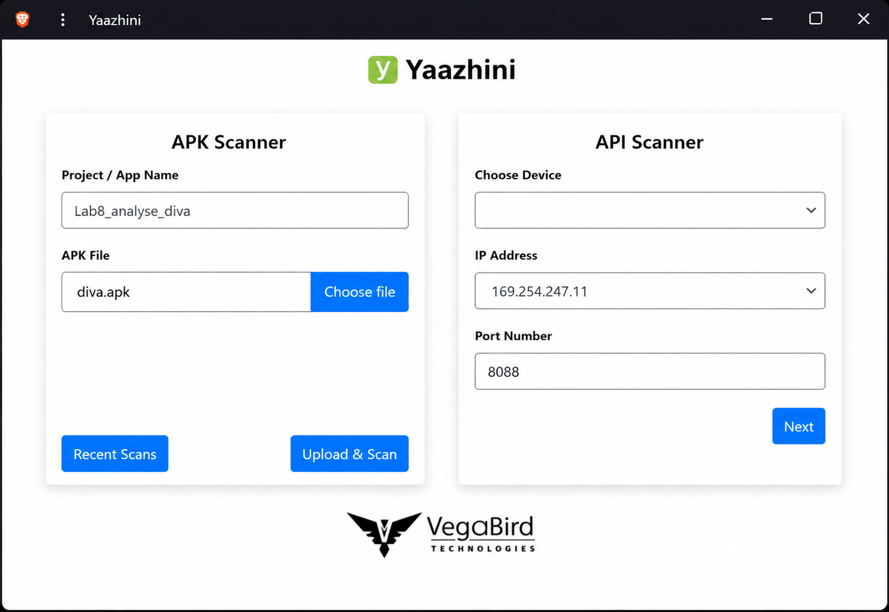
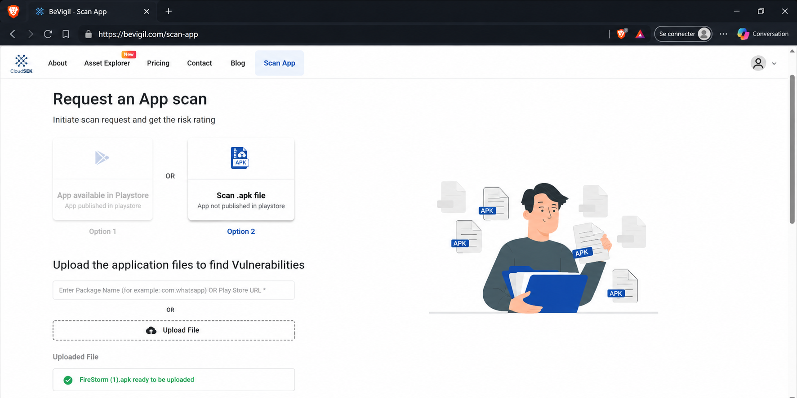
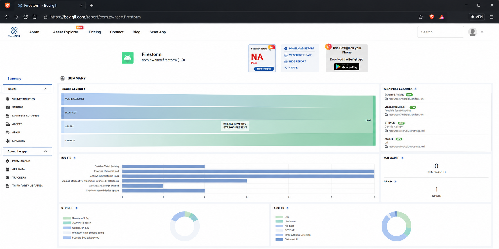
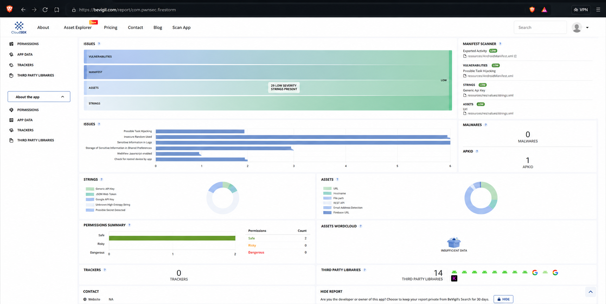
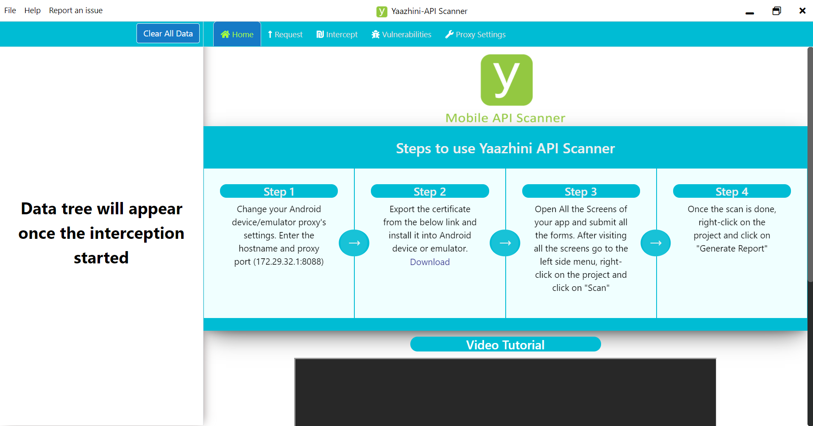
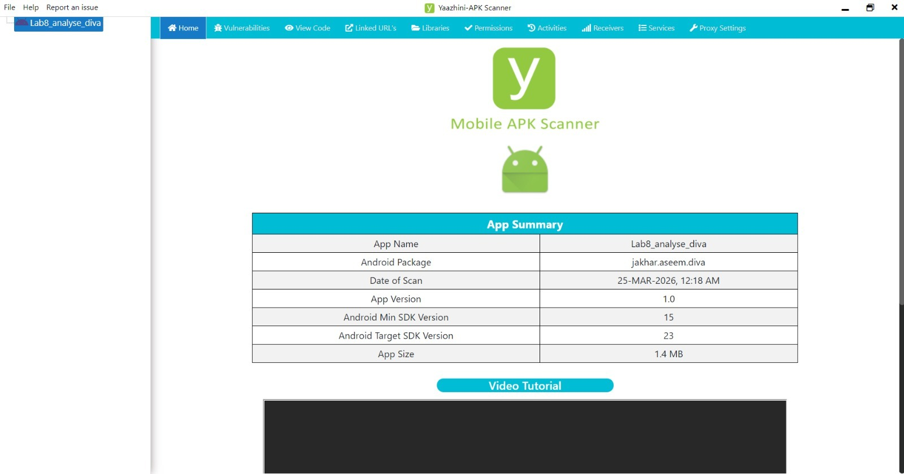
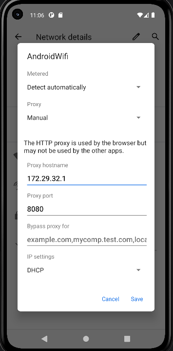

# Lab 8 — Analyse de sécurité d’une application Android avec Yaazhini et BeVigil

## 1. Introduction

Ce laboratoire consiste à réaliser une analyse de sécurité d’une application Android à partir d’un fichier APK.  
L’objectif est d’utiliser plusieurs outils de cybersécurité mobile afin d’identifier les vulnérabilités potentielles, les permissions, les informations sensibles, les bibliothèques tierces, les assets, les strings et les configurations exposées dans l’application.

Les outils utilisés dans ce lab sont :

- Yaazhini APK Scanner
- Yaazhini API Scanner
- BeVigil / CloudSEK
- Android Emulator
- Brave Browser
- APK Android : diva.apk

Ce travail est réalisé uniquement dans un cadre pédagogique, défensif et autorisé.

---

## 2. Objectifs du lab

Les objectifs principaux de ce laboratoire sont :

- Préparer l’environnement d’analyse mobile.
- Importer un fichier APK dans Yaazhini.
- Lancer une analyse statique de l’application Android.
- Utiliser BeVigil pour obtenir un rapport de sécurité complémentaire.
- Préparer l’interception du trafic API avec Yaazhini API Scanner.
- Configurer le proxy dans l’émulateur Android.
- Identifier les vulnérabilités et les éléments sensibles.
- Rédiger un mini-rapport clair sur les résultats obtenus.

---

## 3. Périmètre du lab

L’application analysée dans ce laboratoire est une application Android utilisée dans un cadre académique.

Informations principales :

| Élément | Valeur |
|---|---|
| Nom du projet | Lab8_analyse_diva |
| Fichier APK | diva.apk |
| Outil principal | Yaazhini |
| Outil complémentaire | BeVigil |
| Type d’analyse | Analyse statique et préparation à l’analyse dynamique |
| Cadre | Pédagogique et défensif |

---

## 5. Démarrage de Yaazhini

Après le lancement de Yaazhini, l’interface principale affiche deux modules :

- APK Scanner
- API Scanner

Dans la partie APK Scanner, on renseigne le nom du projet :

**Lab8_analyse_diva**

Ensuite, on sélectionne le fichier APK :

**diva.apk**

Puis, on clique sur le bouton :

**Upload & Scan**

Cette étape permet de lancer l’analyse statique de l’application Android.

---

## 6. Analyse de l’APK avec BeVigil

Pour compléter l’analyse locale réalisée avec Yaazhini, nous avons utilisé la plateforme BeVigil.

L’URL utilisée est :

**https://bevigil.com/scan-app**

Sur la page de scan, deux possibilités sont proposées :

- Analyser une application disponible sur Play Store.
- Importer directement un fichier APK.

Dans notre cas, nous avons choisi l’option :

**Scan .apk file**

Ensuite, le fichier APK est importé dans la plateforme.

Le fichier affiché comme prêt à être analysé est :

**FireStorm (1).apk**

Une fois le fichier importé, BeVigil indique que l’application est prête pour l’analyse.

---

## 7. Résultat général du rapport BeVigil

Après l’analyse, BeVigil génère un rapport global de sécurité.

Les informations principales affichées dans le rapport sont :

| Élément | Résultat |
|---|---|
| Application | Firestorm |
| Package | com.pwnsec.firestorm |
| Version | 1.0 |
| Security Rating | NA |
| Malwares détectés | 0 |
| APKID | 1 |

Le rapport affiche aussi plusieurs catégories d’analyse :

- Vulnerabilities
- Manifest Scanner
- Strings
- Assets
- Permissions
- App Data
- Trackers
- Third Party Libraries

Cette partie permet d’avoir une vue générale sur le niveau d’exposition de l’application.

---

## 8. Analyse détaillée des résultats BeVigil

Dans la partie détaillée du rapport, plusieurs éléments de sécurité sont identifiés.

Les principaux points affichés sont :

- Possible Task Hijacking
- Insecure Random Used
- Sensitive Information in Logs
- Storage of Sensitive Information in Shared Preferences
- WebView JavaScript Enabled
- Check for rooted device by app

Ces éléments montrent que l’application contient plusieurs zones qui doivent être vérifiées manuellement.

Le rapport indique aussi :

| Élément | Valeur |
|---|---|
| Permissions Safe | 2 |
| Permissions Risky | 0 |
| Permissions Dangerous | 0 |
| Trackers | 0 |
| Third Party Libraries | 14 |
| Malwares | 0 |

Même si aucun malware n’est détecté, certaines configurations peuvent représenter un risque si elles sont mal utilisées.

---

## 9. Configuration de Yaazhini API Scanner

La partie Yaazhini API Scanner permet de préparer l’analyse dynamique du trafic réseau.

L’outil affiche quatre étapes principales :

1. Modifier les paramètres proxy de l’émulateur Android.
2. Exporter le certificat et l’installer sur l’émulateur.
3. Ouvrir les écrans de l’application et soumettre les formulaires.
4. Générer le rapport après la fin du scan.

Dans l’interface, l’adresse proxy affichée est :

| Paramètre | Valeur |
|---|---|
| Proxy hostname | 172.29.32.1 |
| Proxy port | 8088 |

Le message affiché dans la partie gauche indique :

**Data tree will appear once the interception started**

Cela signifie que les données interceptées apparaîtront lorsque l’interception du trafic commencera.

---

## 10. Rapport Yaazhini APK Scanner

Après l’analyse statique avec Yaazhini APK Scanner, l’outil affiche un résumé de l’application.

Les informations principales affichées sont :

| Élément | Valeur |
|---|---|
| App Name | Lab8_analyse_diva |
| Android Package | jakhar.aseem.diva |
| Date of Scan | 25-MAR-2026, 12:18 AM |
| App Version | 1.0 |
| Android Min SDK Version | 15 |
| Android Target SDK Version | 23 |
| App Size | 1.4 MB |

Ces informations permettent d’identifier précisément l’application analysée, sa version, son package Android, son SDK minimum, son SDK cible et sa taille.

---

## 11. Configuration du proxy Android

Pour permettre à Yaazhini API Scanner d’intercepter le trafic réseau de l’application, il faut configurer le proxy dans l’émulateur Android.

Les étapes suivies sont :

1. Ouvrir les paramètres Wi-Fi de l’émulateur.
2. Sélectionner le réseau AndroidWifi.
3. Ouvrir les détails du réseau.
4. Modifier la configuration du proxy.
5. Choisir le mode Manual.
6. Renseigner le proxy hostname.
7. Renseigner le proxy port.
8. Enregistrer la configuration.

Les valeurs utilisées dans l’émulateur sont :

| Paramètre | Valeur |
|---|---|
| Proxy hostname | 172.29.32.1 |
| Proxy port | 8080 |

Après cette configuration, le trafic réseau de l’émulateur peut être redirigé vers l’outil d’analyse.

---

## 12. Analyse des catégories détectées

### 12.1 Manifest Scanner

Le fichier AndroidManifest.xml est un élément essentiel dans une application Android.  
Il contient les composants principaux de l’application, comme les activités, les services, les permissions et les receivers.

Les risques possibles liés au manifeste sont :

- Activités exportées inutilement.
- Permissions sensibles.
- Services accessibles depuis l’extérieur.
- Mauvaise configuration des composants.
- Risque de Task Hijacking.

Dans ce lab, BeVigil indique un risque lié au manifeste avec une sévérité faible.

---

### 12.2 Strings

La catégorie Strings permet d’identifier les chaînes de caractères présentes dans l’application.

Ces chaînes peuvent contenir :

- Des URLs.
- Des clés API.
- Des tokens.
- Des secrets.
- Des noms de domaines.
- Des messages internes.
- Des informations de configuration.

Dans le rapport, plusieurs strings sont détectées avec une sévérité faible.  
Elles doivent être vérifiées pour confirmer qu’aucune information sensible n’est exposée.

---

### 12.3 Assets

Les assets sont les fichiers embarqués dans l’application.

Ils peuvent contenir :

- Des fichiers de configuration.
- Des ressources internes.
- Des URLs.
- Des fichiers utilisés par l’application.
- Des données sensibles.

Même si le niveau de risque est faible, il faut vérifier que les assets ne contiennent pas d’informations confidentielles.

---

### 12.4 Permissions

Les permissions Android indiquent les droits demandés par l’application.

Dans ce lab, le rapport affiche :

| Type de permission | Nombre |
|---|---|
| Safe | 2 |
| Risky | 0 |
| Dangerous | 0 |

Cela signifie que l’application ne demande pas de permission dangereuse selon le rapport affiché.

---

### 12.5 Third Party Libraries

Le rapport indique la présence de :

**14 third party libraries**

Les bibliothèques tierces doivent être vérifiées car elles peuvent contenir des vulnérabilités si elles sont anciennes, mal configurées ou non maintenues.

---

### 12.6 Malware

Le rapport indique :

**0 malwares**

Cela signifie qu’aucun malware n’a été détecté dans l’application analysée par BeVigil.

---

## 13. Corrélation avec OWASP Mobile

Les résultats obtenus peuvent être reliés aux catégories de risques OWASP Mobile.

| Élément détecté | Risque possible | Catégorie OWASP Mobile associée |
|---|---|---|
| Sensitive Information in Logs | Exposition d’informations sensibles | Insecure Data Storage |
| Shared Preferences sensibles | Stockage local non sécurisé | Insecure Data Storage |
| WebView JavaScript Enabled | Risque lié à WebView | Security Misconfiguration |
| Possible Task Hijacking | Mauvaise configuration des activités | Improper Platform Usage |
| Strings sensibles | Secrets dans le code | Extraneous Functionality |
| Third Party Libraries | Dépendances vulnérables | Security Misconfiguration |

Cette corrélation permet de mieux comprendre l’impact potentiel des résultats détectés.

---

## 14. Synthèse des résultats

| Élément | Résultat |
|---|---|
| Application analysée | Lab8_analyse_diva |
| APK utilisé | diva.apk |
| Package Yaazhini | jakhar.aseem.diva |
| Application BeVigil | Firestorm |
| Package BeVigil | com.pwnsec.firestorm |
| Malwares détectés | 0 |
| APKID | 1 |
| Permissions dangereuses | 0 |
| Trackers | 0 |
| Third Party Libraries | 14 |
| Outil d’analyse statique | Yaazhini APK Scanner |
| Outil complémentaire | BeVigil |
| Analyse dynamique préparée | Oui, via proxy Android |

---

## 15. Mini-rapport

L’analyse de sécurité de l’application Android a permis d’obtenir une vision globale de son niveau d’exposition.

L’utilisation de Yaazhini a permis d’extraire les informations techniques de l’application, comme le nom, le package, la version, le SDK minimum, le SDK cible et la taille de l’APK.

L’utilisation de BeVigil a permis d’obtenir un rapport plus détaillé sur les vulnérabilités potentielles, les permissions, les strings, les assets, les trackers, les malwares et les bibliothèques tierces.

Les résultats montrent qu’aucun malware n’a été détecté et qu’aucune permission dangereuse n’apparaît dans le résumé. Cependant, plusieurs points doivent être vérifiés manuellement, notamment les informations sensibles dans les logs, les données stockées dans Shared Preferences, les strings sensibles et les bibliothèques tierces.

La configuration du proxy dans l’émulateur Android permet de préparer une analyse dynamique du trafic réseau avec Yaazhini API Scanner. Cette étape est importante pour observer les requêtes envoyées par l’application et identifier les endpoints, domaines et communications éventuelles.

---

## 16. Recommandations

À partir des résultats observés, les recommandations suivantes peuvent être proposées :

- Vérifier les informations sensibles présentes dans les logs.
- Éviter de stocker des données sensibles dans Shared Preferences sans chiffrement.
- Supprimer les clés API, tokens ou secrets présents en clair dans les strings.
- Vérifier la configuration du fichier AndroidManifest.xml.
- Contrôler les activités exportées.
- Mettre à jour les bibliothèques tierces.
- Désactiver JavaScript dans WebView lorsqu’il n’est pas nécessaire.
- Utiliser un stockage sécurisé pour les données sensibles.
- Réaliser une analyse dynamique complète du trafic réseau.
- Documenter chaque vulnérabilité avec son niveau de risque.

---

## 17. Nettoyage et clôture

À la fin du laboratoire, les actions suivantes doivent être réalisées :

- Fermer Yaazhini.
- Désactiver le proxy dans l’émulateur Android.
- Supprimer les fichiers temporaires.
- Conserver uniquement les captures utiles.
- Sauvegarder le rapport final.
- Vérifier que le README contient toutes les étapes réalisées.

---

## 18. Conclusion

Ce laboratoire a permis de réaliser une analyse de sécurité d’une application Android à l’aide de Yaazhini et BeVigil.

L’analyse statique a permis d’identifier les informations principales de l’APK et les éléments internes de l’application.  
L’analyse via BeVigil a permis de compléter cette étude avec un rapport détaillé sur les vulnérabilités, les permissions, les strings, les assets, les malwares et les bibliothèques tierces.  
La configuration du proxy Android a permis de préparer l’analyse dynamique du trafic réseau.

Ce lab montre l’importance d’utiliser plusieurs outils pour analyser une application Android, car chaque outil fournit une vision différente et complémentaire de la sécurité de l’application.

---

