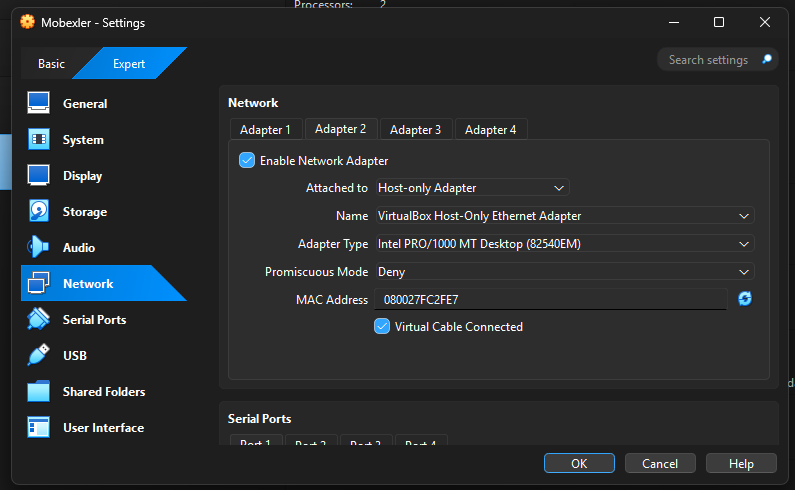
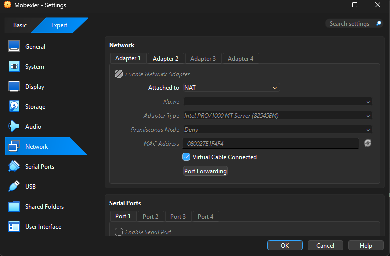
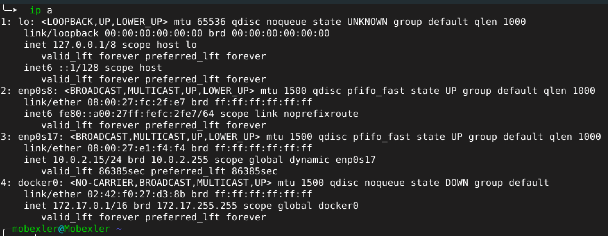
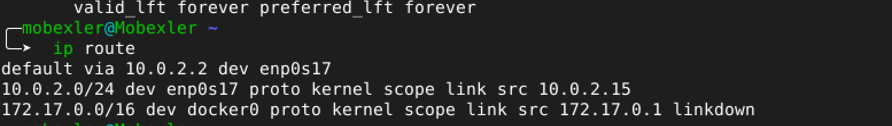
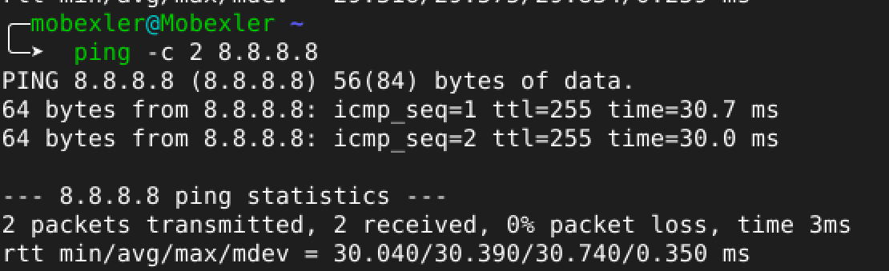
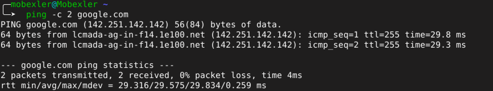
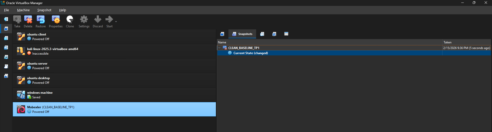
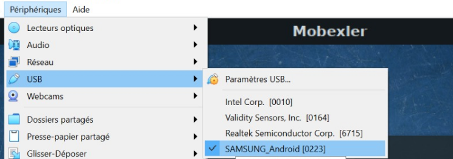
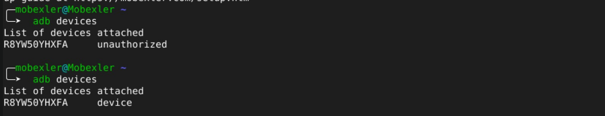

1 . Configuration Réseau – Adaptateur 1 (Host-Only) 

    configuration montre l’activation de l’adaptateur réseau en mode Host-Only

2 . Configuration Réseau – Adaptateur 2 (NAT)

    L’adaptateur 2 est configuré en mode NAT
 

3 . Vérification des Interfaces Réseau (commande ip a)

    La commande ip a permet d’afficher les interfaces réseau actives.

4 . Vérification de la Table de Routage (ip route)

    La route par défaut est définie via 10.0.2.2, ce qui correspond à la passerelle NAT de VirtualBox.

5 . Test de Connectivité – Ping vers 8.8.8.8

    Un test de connectivité vers l’adresse IP 8.8.8.8 (Google DNS) a été effectué.

6 . Test de Résolution DNS – Ping vers google.com

    Le ping vers google.com permet de vérifier la résolution DNS.

7 . Gestion des Snapshots – VirtualBox

    Un snapshot nommé CLEAN_BASELINE_TP1 a été créé.

8 . Préparer la cible Android 

