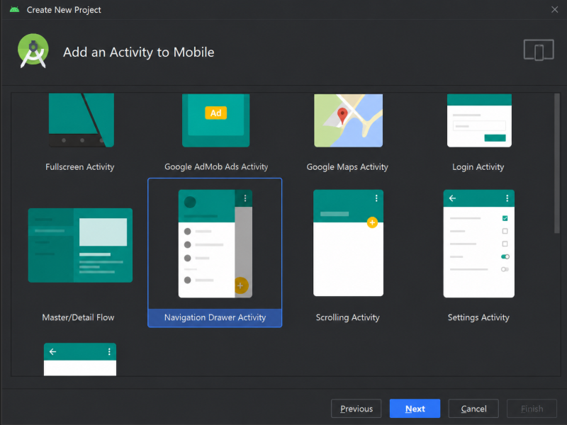
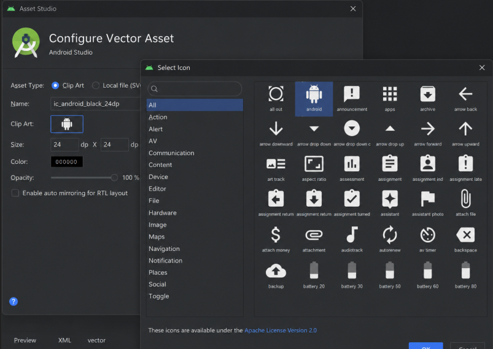
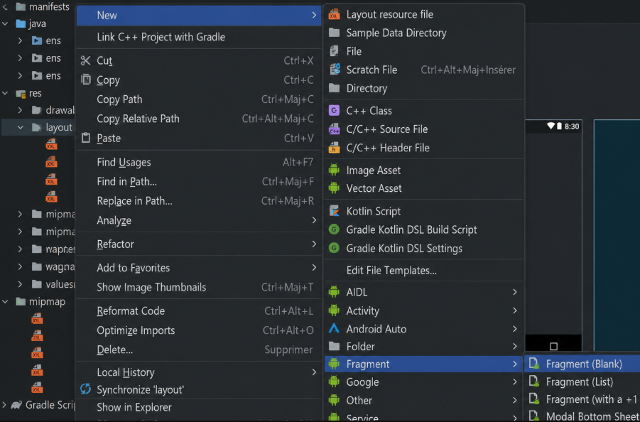
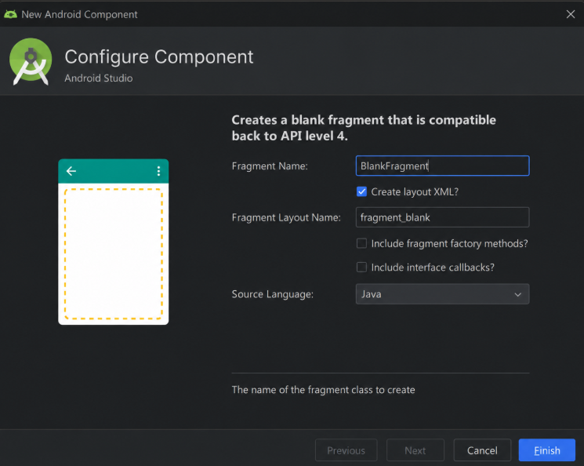
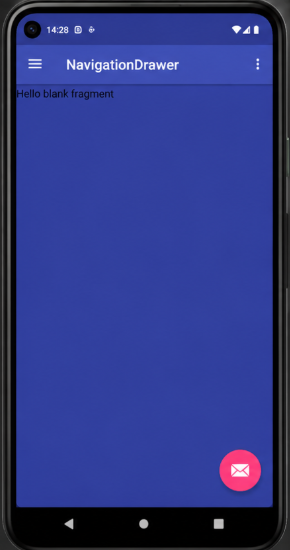
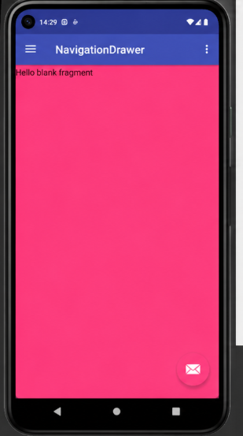
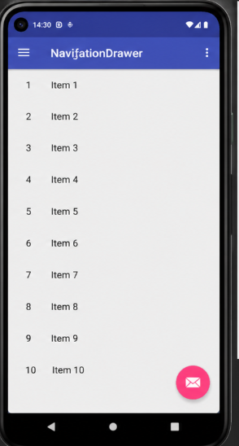

# lab 10 - Application Android Navigation Drawer

## Description du projet

Cette application Android montre comment créer une interface mobile avec un menu latéral.  
Le menu permet de naviguer entre plusieurs pages internes appelées fragments.

Le projet contient trois interfaces :

- Une interface bleue.
- Une interface rose.
- Une interface contenant une liste d’items.

L’application a été développée sous Android Studio avec Java et XML, puis testée avec un émulateur Pixel 5.

## Objectifs du travail

Les objectifs de ce projet sont :

- Créer une application Android simple.
- Ajouter un Navigation Drawer.
- Modifier le menu latéral.
- Créer des icônes avec Vector Asset.
- Créer plusieurs fragments.
- Afficher les fragments selon le choix du menu.
- Ajouter un fragment de type liste.
- Tester le résultat final sur un émulateur Android.

## Outils utilisés

Android Studio  
Java  
XML  
Navigation Drawer  
Fragments  
ListFragment  
Vector Asset  
Pixel 5 Emulator  

## Emplacement des images

Les captures d’écran doivent être mises dans un dossier nommé images.

Le dossier images doit être placé directement à la racine du projet.

Les images doivent être renommées et placées comme ceci :

images/img01_creation_projet.png
images/img02_creation_icones.png
images/img03_ajout_fragment.png
images/img04_configuration_fragment.png
images/img05_fragment_bleu.png
images/img06_fragment_rose.png
images/img07_liste_items.png

## Captures du projet

### Création du projet

Cette capture montre la fenêtre de création du projet Android avec le modèle Navigation Drawer Activity.

### Création des icônes

Cette image montre la configuration des icônes du menu avec l’outil Vector Asset.

### Ajout d’un fragment

Cette capture montre le menu utilisé pour ajouter un nouveau fragment dans le projet.

### Configuration du composant

Cette image montre la configuration du fragment BlankFragment avec son fichier XML.

### Premier fragment

Cette capture montre le premier écran de l’application avec un fond bleu.

### Deuxième fragment

Cette capture montre le deuxième écran de l’application avec un fond rose.

### Fragment liste

Cette capture montre le troisième écran avec une liste allant de Item 1 à Item 10.

## Principe de fonctionnement

Le Navigation Drawer permet d’ouvrir un menu latéral à partir de l’icône hamburger située en haut de l’application.

Chaque élément du menu est lié à un fragment.

Quand l’utilisateur choisit un élément du menu, le fragment correspondant est affiché dans le conteneur principal.

Le changement de fragment se fait avec le FragmentManager.

Exemple :

getSupportFragmentManager()
        .beginTransaction()
        .replace(R.id.content, new BlankFragment())
        .commit();

## Résultat obtenu

Le résultat final est une application Android fonctionnelle avec :

- Une barre d’action en haut.
- Une icône hamburger.
- Un menu latéral.
- Trois fragments.
- Un bouton flottant FAB.
- Une liste simple.
- Un affichage adapté à l’émulateur Pixel 5.

## Conclusion

Ce projet est un bon exemple pour apprendre la navigation entre plusieurs fragments dans Android.  
Il permet aussi de comprendre l’utilisation du Navigation Drawer, des layouts XML, des icônes vectorielles et du ListFragment.

