#  Lab 10 : Instrumentation Dynamique avec Frida (Android)

Ce dépôt documente mon analyse dynamique de l'application Android vulnérable **Diva** (Damn Insecure and Vulnerable App) en utilisant **Frida**. L'objectif est de démontrer l'interception et la modification du comportement de l'application en temps réel (Natif et Java).

---

##  1. Préparation de l'environnement

Pour commencer, j'ai mis en place l'environnement de travail sur ma machine hôte en installant les outils nécessaires (Python, pip, frida et frida-tools).

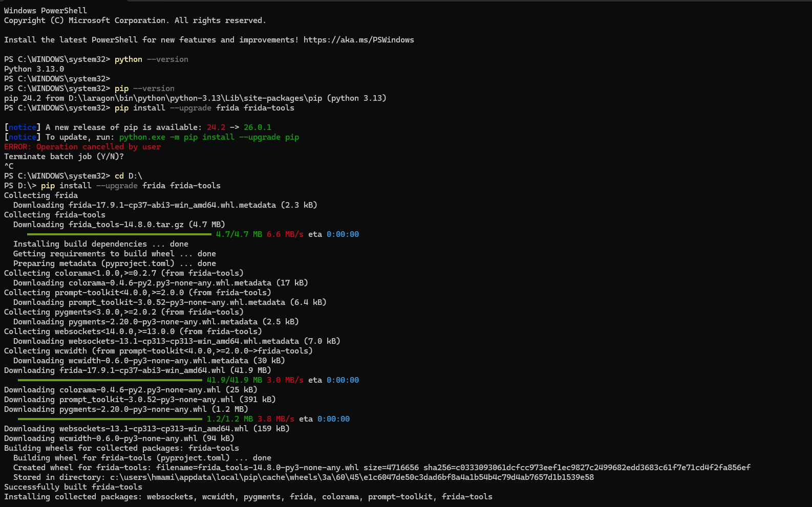

Avant de déployer le serveur Frida sur l'émulateur, il est crucial de connaître son architecture. J'ai utilisé la commande `adb shell getprop ro.product.cpu.abi` qui m'a confirmé que l'émulateur tourne sous **x86**.

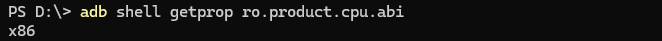

J'ai ensuite téléchargé la version correspondante de `frida-server` pour cette architecture.

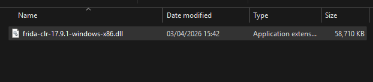

Le fichier a été poussé dans le répertoire temporaire de l'émulateur (`/data/local/tmp/`) en utilisant `adb push`.

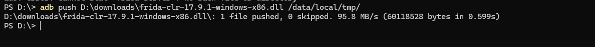

Pour que le système Android autorise l'exécution de ce binaire, je lui ai attribué les droits d'exécution nécessaires avec la commande `chmod 755`.

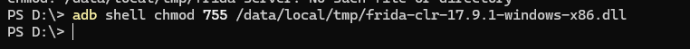

Le serveur Frida a ensuite été lancé directement depuis le shell de l'émulateur.

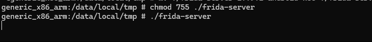

Enfin, pour que mon PC puisse communiquer avec le serveur sur l'émulateur, j'ai configuré la redirection des ports (`adb forward`). La commande `frida-ps -U` m'a permis de lister les processus et de confirmer que la connexion était parfaitement établie.

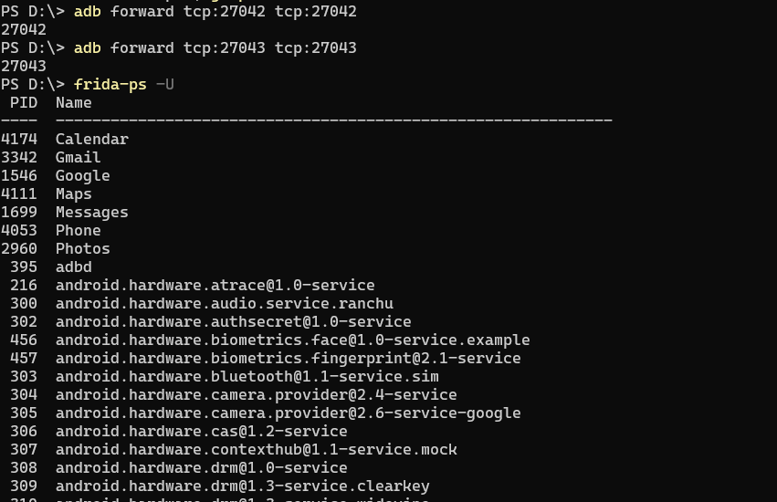

---

##  2. Validation des Injections (Hooking Basique)

Avant de chercher des vulnérabilités, j'ai validé la capacité de Frida à s'injecter dans l'application Diva au niveau Java. Le script `Hello.js` a retourné un succès (`Frida Java.perform OK`).

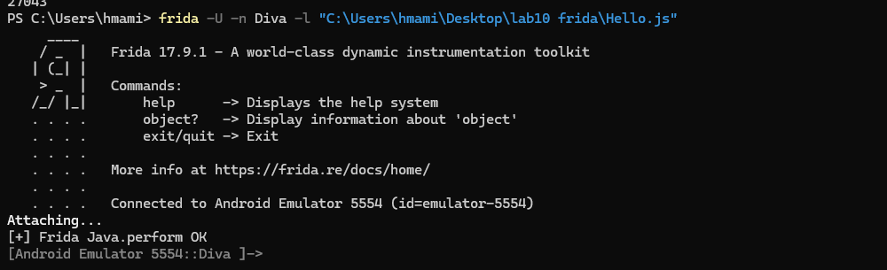

J'ai effectué la même validation pour la couche Native (C/C++) avec le script `hello_native.js`, confirmant que Frida pouvait s'attacher aux adresses mémoire de bas niveau.

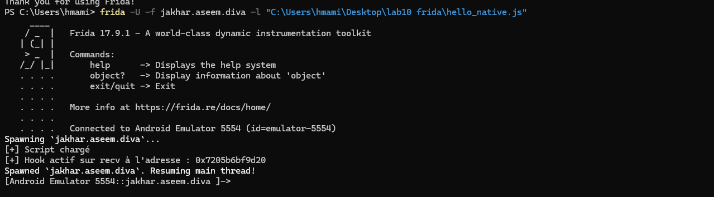

Pour préparer des hooks plus avancés, j'ai exploré dynamiquement l'environnement avec la console interactive Frida, identifiant l'architecture exacte (`Process.arch`) et localisant l'adresse mémoire de la fonction native `connect` dans la bibliothèque `libc.so`.

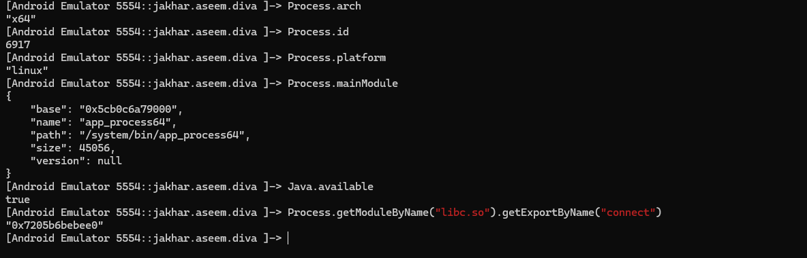

---

##  3. Audit de la couche Native (Réseau & Fichiers)

L'analyse de la couche native permet de voir ce que l'application fait "sous le capot". J'ai commencé par intercepter les appels réseau avec un hook sur la fonction `connect`.

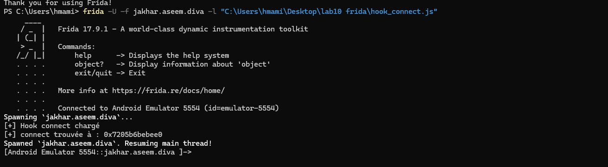

Pour aller plus loin dans l'analyse réseau, le script `hook_network.js` a été déployé pour cibler simultanément les fonctions d'envoi (`send`) et de réception (`recv`).

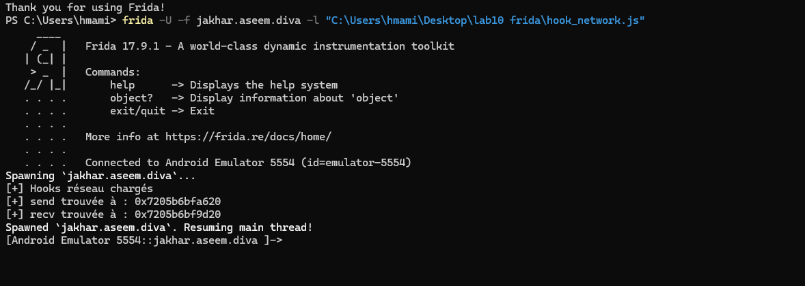

Ensuite, j'ai audité le système de fichiers. J'ai d'abord créé une version ciblée de `hook_file.js` pour surveiller la fonction `open`, avec un filtre n'affichant que les fichiers liés à l'application Diva pour éviter le bruit du système.

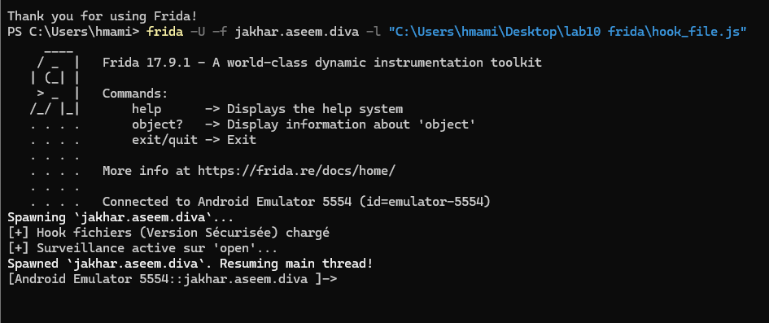

Face aux spécificités des architectures modernes qui utilisent d'autres appels système, j'ai amélioré ce script en une version "Universelle" capable d'intercepter à la fois `open` et `openat`.

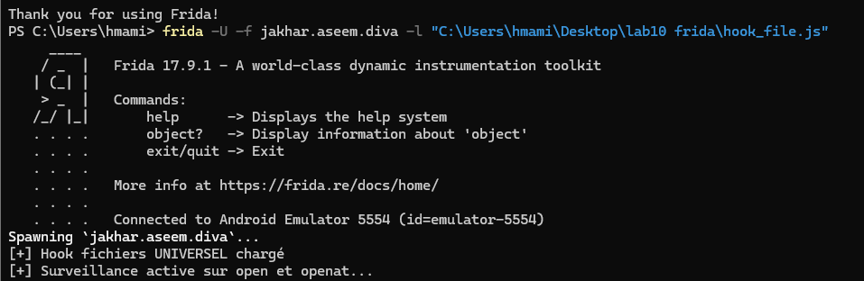

---

##  4. Exploitation des Vulnérabilités (Insecure Data Storage)

C'est ici que l'audit révèle les failles critiques. Dans l'exercice de stockage non sécurisé de Diva, l'utilisateur est invité à sauvegarder des identifiants.

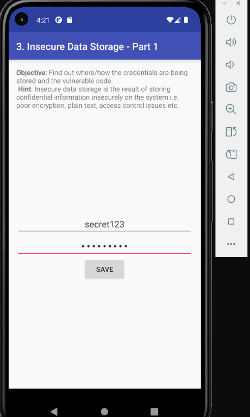

Plutôt que de chercher le fichier sur le disque, j'ai injecté un script Java (`hook_prefs_write.js`) pour intercepter la méthode `putString` des SharedPreferences. Dès que le bouton "SAVE" est cliqué, le script capture les actions.

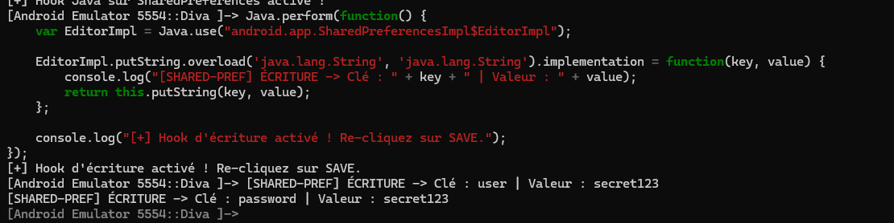

Le résultat est sans appel : les mots de passe et identifiants sont interceptés et affichés **en clair** dans la console au moment exact de leur enregistrement.

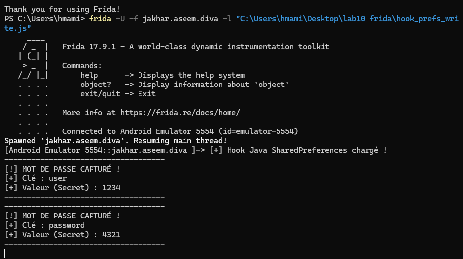

J'ai répété cette méthodologie pour les bases de données SQLite. En interceptant `execSQL` et `rawQuery`, mon script a pu capturer les requêtes `CREATE TABLE` et surtout l'insertion (`INSERT INTO`) des identifiants non chiffrés.

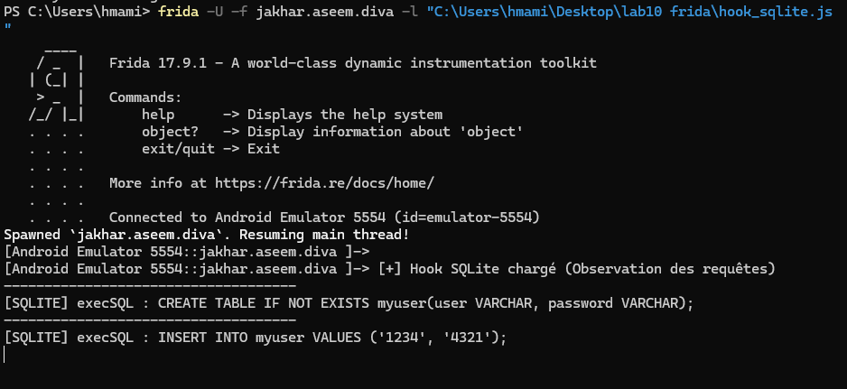

---

##  5. Surveillance Avancée et Évasion

Pour clôturer l'audit, j'ai vérifié si l'application tentait de se défendre contre l'analyse dynamique. J'ai déployé un script pour intercepter la fonction anti-débogage (`isDebuggerConnected`).

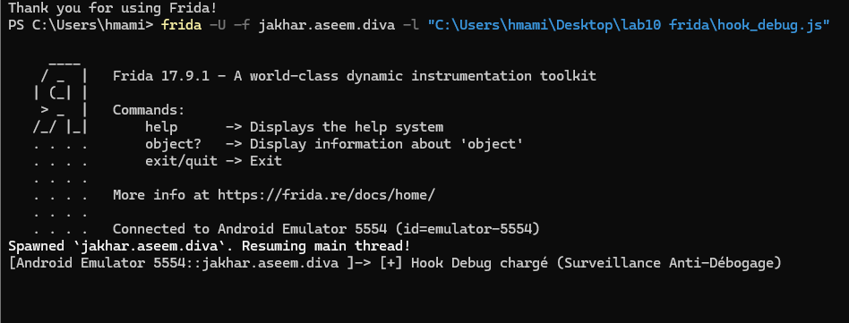

Enfin, j'ai surveillé les appels système via `Runtime.exec()`. Cette technique est souvent utilisée par les applications pour lancer des commandes shell (comme chercher le binaire `su`) afin de détecter si l'appareil est rooté.

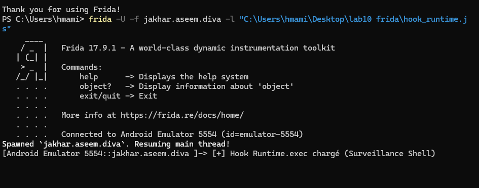

##  Conclusion
L'utilisation de Frida prouve que même si une application masque ses données à l'écran, toute information manipulée en mémoire (SharedPreferences, requêtes SQLite) peut être interceptée si elle n'est pas correctement chiffrée (via l'Android Keystore par exemple) avant son traitement.

