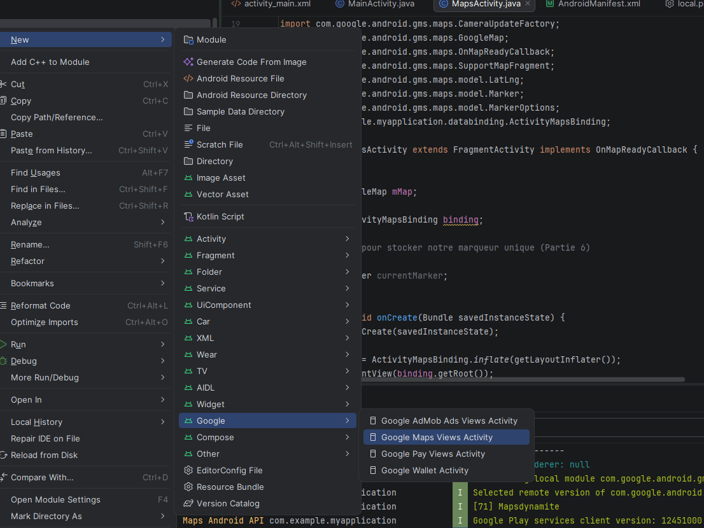
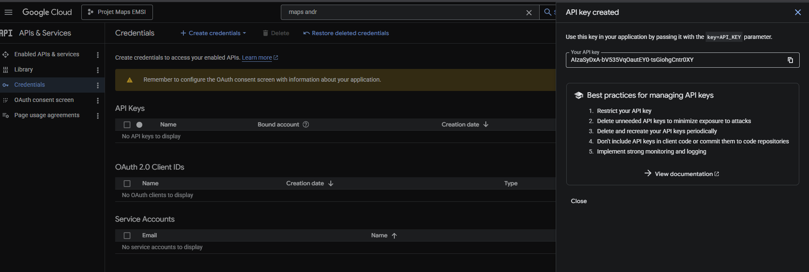
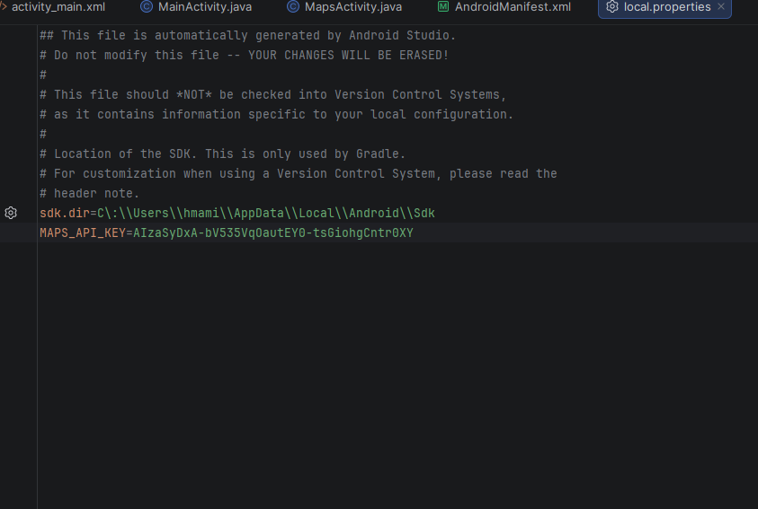
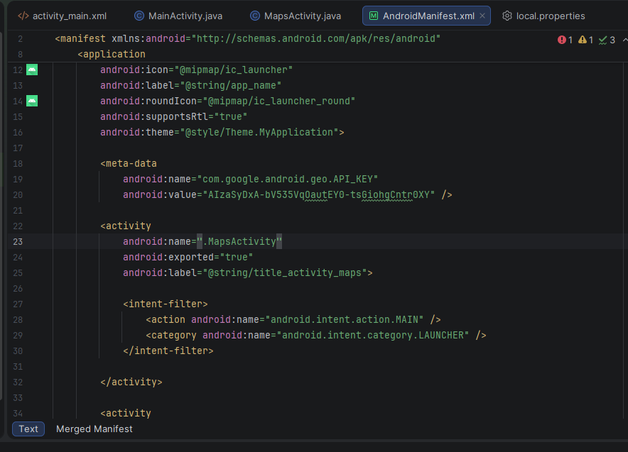
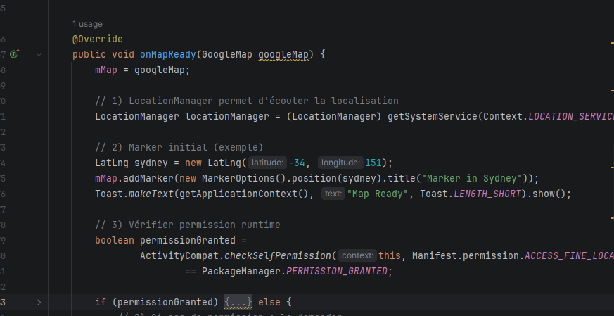
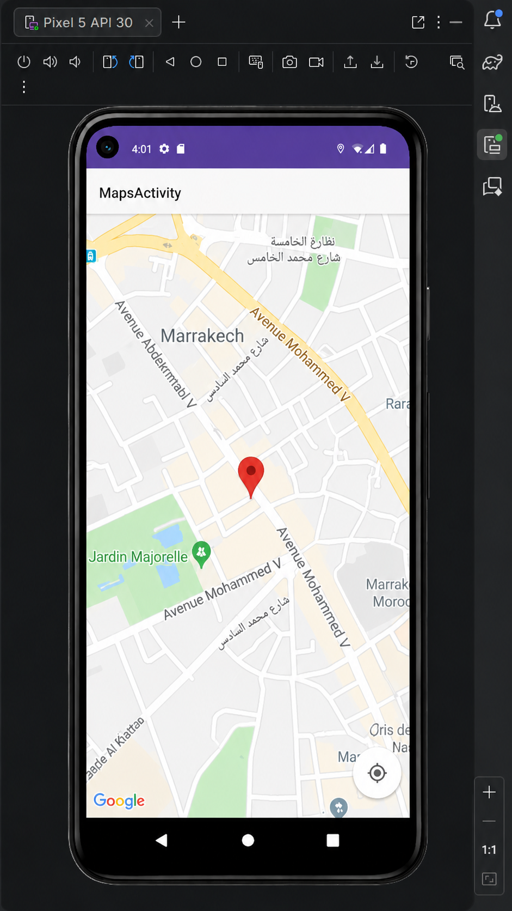
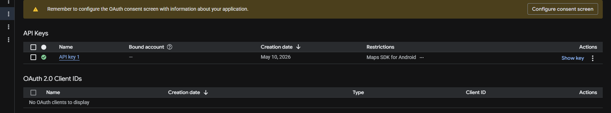

# Intégration de Google Maps et Géolocalisation - Android

##  Objectif du Projet
Ce projet est une application Android développée dans le cadre d'un travail pratique (TP) d'ingénierie. Son objectif principal est de démontrer l'intégration réussie de l'API **Google Maps SDK for Android** et l'exploitation du service de géolocalisation de l'appareil pour suivre et afficher la position de l'utilisateur en temps réel.

##  Technologies et Outils Utilisés
* **Environnement de développement :** Android Studio
* **Langage :** Java / XML
* **API :** Google Maps SDK for Android
* **Services système :** `LocationManager`, Permissions Runtime

---

##  Étapes de Réalisation

### 1. Création et initialisation du projet
Pour démarrer, nous avons intégré une activité spécifique à Google Maps directement depuis les modèles d'Android Studio afin de générer la structure de base.

*Figure 1 : Ajout d'une Google Maps Views Activity au projet.*

### 2. Génération de la clé API (Google Cloud Console)
Afin d'autoriser l'application à télécharger les tuiles de la carte, un projet a été créé sur la **Google Cloud Console**. Le service "Maps SDK for Android" a été activé et une clé API sécurisée a été générée.

*Figure 2 : Génération de la clé API sur la console Google Cloud.*

### 3. Configuration de l'environnement (Manifest & Sécurité)
Les bonnes pratiques exigent de ne pas exposer la clé API en clair dans le code. Elle a d'abord été déclarée dans le fichier `local.properties`.

*Figure 3 : Sécurisation de la clé API dans le fichier local.properties.*

Ensuite, le fichier `AndroidManifest.xml` a été mis à jour pour pointer vers cette variable. Nous avons également déplacé l'`intent-filter` vers `MapsActivity` pour faire de la carte l'écran de démarrage par défaut de l'application. *(Note : La capture ci-dessous montre un test en dur de la clé pour des besoins de débogage).*

*Figure 4 : Déclaration des metadonnées de l'API et point d'entrée de l'application.*

### 4. Implémentation de la logique Java (Permissions et GPS)
Le cœur de l'application se trouve dans `MapsActivity.java`. L'implémentation comprend :
* La vérification des permissions dynamiques (`ACCESS_FINE_LOCATION`).
* L'instanciation du `LocationManager`.
* La mise en place d'un écouteur pour récupérer les coordonnées GPS en temps réel.

*Figure 5 : Extrait du code gérant l'initialisation de la carte et la vérification des permissions.*

### 5. Phase de Test et Débogage
Lors des premiers tests sur l'émulateur, un problème réseau/authentification empêchait le téléchargement de la carte (fond beige). Cependant, un message Toast a confirmé que l'implémentation Java fonctionnait parfaitement, récupérant avec succès les coordonnées simulées de Marrakech (31.633... , -8.039...).

### 6. Résultat Final Validé
Après résolution du problème de pont réseau de l'émulateur (Cold Boot) et vérification des restrictions de la clé API, la carte s'affiche correctement. L'application pointe de manière fluide et dynamique sur la position simulée de l'appareil.

 

---

##  Auteur
**Mohamed Hmami** *Élève Ingénieur, 4ème année - Spécialité Systèmes, Réseaux et Cybersécurité (EMSI).*

