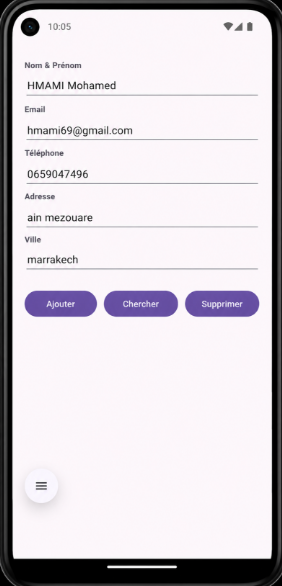
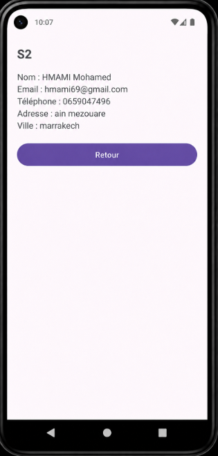

# LAB 15 : SQLite et Android – Gestion simple des étudiants
### Cours : Programmation Mobile – Android avec Java

---

##  Aperçu

Réaliser une application Android minimale de gestion des étudiants basée sur une base **SQLite embarquée**. Le travail couvre :
- Une couche métier (modèle `Etudiant`)
- Une couche d'accès aux données (`SQLiteOpenHelper` + service CRUD)
- Une couche présentation (test Logcat puis interface graphique)

---

##  Objectifs d'apprentissage

| # | Objectif |
|---|----------|
| 1 | Créer un modèle métier `Etudiant` |
| 2 | Initialiser une base SQLite locale avec `SQLiteOpenHelper` |
| 3 | Implémenter des opérations CRUD via un service dédié |
| 4 | Tester les services via Logcat |
| 5 | Développer une interface simple (Ajouter, Chercher, Supprimer) |

---

##  Réalisations

###  Interface principale – Formulaire étudiant





---

###  Écran détail – Résultat de recherche 



---

##  Architecture du projet

```
app/src/main/java/com.example.lab15/
│
├── model/
│   └── Etudiant.java               ← Couche métier
│
├── database/
│   └── EtudiantOpenHelper.java     ← SQLiteOpenHelper
│
├── service/
│   └── EtudiantService.java        ← CRUD (insert, findAll, delete, findById)
│
├── MainActivity.java               ← UI : Ajouter / Chercher / Supprimer
└── DetailActivity.java             ← UI : Affichage détail étudiant
```

---

## 🧪 Étapes du Lab

### Tâche 1 — Couche métier : modèle `Etudiant`
- Créer la classe `Etudiant` avec les champs : `id`, `nom`, `email`, `telephone`, `adresse`, `ville`
- Ajouter constructeurs, getters/setters et `toString()`

### Tâche 2 — Accès aux données : `SQLiteOpenHelper` + Service CRUD
- Créer `EtudiantOpenHelper` (création de table, version, upgrade)
- Créer `EtudiantService` avec les méthodes : `insert()`, `findAll()`, `findById()`, `delete()`

### Tâche 3 — Présentation : test Logcat
- Tester `insert` / `findAll` / `delete` depuis `MainActivity`
- Vérifier les résultats dans **Logcat** (tag filtré)

### Tâche 4 — UI CRUD : layout + événements
- Concevoir le layout avec les champs : Nom, Email, Téléphone, Adresse, Ville
- Brancher les boutons : **Ajouter**, **Chercher**, **Supprimer**
- Créer `DetailActivity` pour l'affichage du résultat de recherche

---

## Vérification

- [ ] La base SQLite est créée sans erreur au premier lancement
- [ ] L'insertion d'un étudiant fonctionne et est visible en Logcat
- [ ] La recherche par ID affiche les bonnes données dans `DetailActivity`
- [ ] La suppression retire bien l'enregistrement de la base
- [ ] Aucun crash sur rotation ou relancement de l'app

---

## 🔧 Compatibilité AndroidX

```groovy
// build.gradle (app)
android {
    compileSdk 34
    defaultConfig {
        minSdk 21
        targetSdk 34
    }
}
dependencies {
    implementation 'androidx.appcompat:appcompat:1.6.1'
    implementation 'com.google.android.material:material:1.11.0'
}
```

---

##  Dépannage

| Problème | Cause probable | Solution |
|----------|---------------|----------|
| `NullPointerException` sur la DB | OpenHelper non initialisé | Vérifier l'appel à `getWritableDatabase()` |
| Table non créée | `onCreate()` non appelé | Désinstaller l'app et relancer |
| Champs vides dans `DetailActivity` | `Intent` mal configuré | Vérifier `putExtra` / `getExtra` |
| App crashe à la rotation | Activité non sauvegardée | Implémenter `onSaveInstanceState()` |

---

##  Récapitulatif

> Ce lab introduit la persistance relationnelle sous Android avec **SQLite natif** (sans ORM).
> L'architecture en 3 couches (modèle / accès données / présentation) pose les bases
> d'un développement Android propre et maintenable.

---

## 👨‍💻 Auteur

**HMAMI Mohamed**
Cours : Programmation Mobile – Android avec Java

