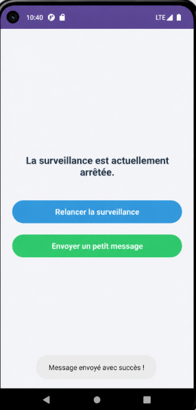

# LAB 17 : Maîtriser les BroadcastReceiver en Android
### Cours : Programmation Mobile – Android avec Java

---

##  Objectifs du lab

Apprendre à créer et utiliser les **BroadcastReceiver** (composants qui réagissent aux événements diffusés par le système ou par votre app).

Vous allez réaliser une application **ReceiverDemo** qui :

| Type | Action |
|------|--------|
| **Receiver dynamique** | Détecte le changement de mode avion (`ACTION_AIRPLANE_MODE_CHANGED`) |
| **Receiver statique** | Réagit au `BOOT_COMPLETED` (démarrage du téléphone) |
| **Broadcast custom** | Envoie et reçoit un broadcast depuis l'Activity |
| **Bonnes pratiques** | Comprend Statique vs Dynamique, cycle de vie `onReceive`, permissions et restrictions Android 14/15/16 |

> À la fin vous saurez exactement comment fonctionnent les notifications système (batterie, WiFi, SMS, etc.) et les broadcasts internes.

---

##  Réalisation

### 📡 Interface principale – ReceiverDemo




*Statut affiché : "La surveillance est actuellement arrêtée." — Message envoyé avec succès !*

---

##  Architecture du projet

```
app/src/main/java/com.example.lab17/
│
├── receiver/
│   ├── AirplaneModeReceiver.java   ← Receiver dynamique (mode avion)
│   ├── BootReceiver.java           ← Receiver statique (BOOT_COMPLETED)
│   └── CustomReceiver.java         ← Receiver custom broadcast
│
└── MainActivity.java               ← UI : Relancer surveillance + Envoyer message

res/layout/
└── activity_main.xml               ← Layout : statut + 2 boutons
```

---

##  Étapes du Lab

### Étape 1 — Créer le projet *(3 min)*
- Nouveau projet Android (Empty Activity)
- Langue : **Java**, `minSdk 21`

### Étape 2 — Créer le Receiver Dynamique (Airplane Mode) *(8 min)*
```java
public class AirplaneModeReceiver extends BroadcastReceiver {
    @Override
    public void onReceive(Context context, Intent intent) {
        boolean isAirplaneModeOn = intent.getBooleanExtra("state", false);
        // Notifier l'Activity du changement
    }
}
```

### Étape 3 — Créer le Receiver Statique (BOOT_COMPLETED) *(5 min)*
```java
public class BootReceiver extends BroadcastReceiver {
    @Override
    public void onReceive(Context context, Intent intent) {
        if (Intent.ACTION_BOOT_COMPLETED.equals(intent.getAction())) {
            // Actions au démarrage du téléphone
        }
    }
}
```

### Étape 4 — Déclarer les Receivers dans le Manifest *(5 min)*
```xml
<!-- Receiver statique -->
<receiver android:name=".receiver.BootReceiver"
    android:exported="true">
    <intent-filter>
        <action android:name="android.intent.action.BOOT_COMPLETED"/>
    </intent-filter>
</receiver>

<!-- Receiver custom -->
<receiver android:name=".receiver.CustomReceiver"
    android:exported="false">
    <intent-filter>
        <action android:name="com.example.lab17.CUSTOM_ACTION"/>
    </intent-filter>
</receiver>
```

### Étape 5 — Modifier l'Activity : Receiver Dynamique + Custom Broadcast *(12 min)*
- Enregistrer `AirplaneModeReceiver` dans `onStart()` / désinscrire dans `onStop()`
- Envoyer un broadcast custom via `sendBroadcast()`
- Mettre à jour le `TextView` statut selon l'état reçu

### Étape 6 — Ajouter un Receiver pour le Custom Broadcast *(5 min)*
- Créer `CustomReceiver` qui affiche un Toast ou met à jour l'UI
- Tester l'envoi depuis le bouton **"Envoyer un petit message"**

### Étape 7 — Layout simple *(2 min)*
- `TextView` statut de surveillance
- Bouton **Relancer la surveillance** (bleu)
- Bouton **Envoyer un petit message** (vert)
- `TextView` confirmation : *"Message envoyé avec succès !"*

### Étape 8 — Lancer et tester *(5 min)*
- Activer/désactiver le mode avion → vérifier la mise à jour du statut
- Appuyer sur **Envoyer un message** → vérifier la réception
- Redémarrer l'émulateur → vérifier `BOOT_COMPLETED` en Logcat

---

##  Vérification

- [ ] Le statut change automatiquement quand le mode avion est activé/désactivé
- [ ] Le broadcast custom est bien reçu et affiché
- [ ] `BOOT_COMPLETED` visible en Logcat au redémarrage
- [ ] Le Receiver dynamique est bien désinscrit dans `onStop()` (pas de fuite)
- [ ] Aucun crash sur Android 14+ (respect des restrictions `exported`)

---

##  Restrictions Android 14/15/16

| Restriction | Solution |
|-------------|----------|
| `exported` obligatoire sur les Receivers statiques | Toujours déclarer `android:exported="true/false"` |
| Broadcasts implicites interdits en arrière-plan | Utiliser des broadcasts explicites ou `LocalBroadcastManager` |
| `BOOT_COMPLETED` nécessite permission | Ajouter `RECEIVE_BOOT_COMPLETED` dans le Manifest |

```xml
<uses-permission android:name="android.permission.RECEIVE_BOOT_COMPLETED"/>
```

---

##  Conclusion & Bonnes pratiques

> - Toujours **désinscrire** un Receiver dynamique dans `onStop()` ou `onDestroy()`
> - Préférer `LocalBroadcastManager` pour les broadcasts internes (plus sécurisé)
> - Ne jamais faire d'opérations longues dans `onReceive()` (pas de réseau, pas de BD)
> - Utiliser `goAsync()` si un traitement asynchrone est nécessaire dans `onReceive()`

---

##  Auteur

**HMAMI Mohamed**
Cours : Programmation Mobile – Android avec Java

