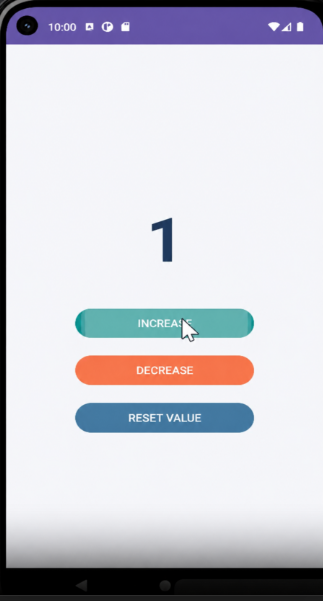
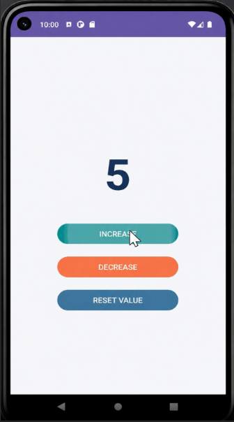

# LAB 18 : ViewModel et LiveData en Android
### Cours : Programmation Mobile – Android avec Java

---

##  Objectifs

- Comprendre **en profondeur** pourquoi une variable classique est perdue à chaque rotation d'écran (changement de configuration)
- Voir concrètement la limite de `onSaveInstanceState()` (ancienne méthode)
- Maîtriser **ViewModel** (survit automatiquement à la destruction/re-création de l'Activity) + **LiveData** (lifecycle-aware : met à jour l'UI seulement quand l'Activity est active)
- Découvrir les concepts internes : `LifecycleOwner`, `Observer`, `ViewModelStore`, `MutableLiveData` vs `LiveData`, `setValue` vs `postValue`
- Tester des scénarios réels : rotation multiple, changement de thème, kill processus, thread background
- Appliquer les meilleures pratiques **Android 2026** (Jetpack 2.10.0 stable)

---

##  Réalisations

###  Compteur à 1 – Incrément en cours




###  Compteur à 5 – Valeur conservée après rotation





---

##  Architecture du projet

```
app/src/main/java/com.example.lab18/
│
├── viewmodel/
│   └── CounterViewModel.java       ← ViewModel : MutableLiveData + logique métier
│
└── MainActivity.java               ← UI : Observer LiveData + boutons

res/layout/
└── activity_main.xml               ← TextView compteur + 3 boutons
```

---

##  Étapes du Lab

### Partie 1 — Version SANS ViewModel/LiveData *(12 min)*
> Le problème classique enrichi

- Déclarer un `int counter` dans `MainActivity`
- Brancher les boutons INCREASE / DECREASE / RESET VALUE
- **Constater** : la valeur est perdue à chaque rotation d'écran
- Tenter de corriger avec `onSaveInstanceState()` → constater ses limites

### Partie 2 — Version AVEC ViewModel + LiveData *(20 min)*

**1. Créer le ViewModel :**
```java
public class CounterViewModel extends ViewModel {
    private final MutableLiveData<Integer> counter = new MutableLiveData<>(0);

    public LiveData<Integer> getCounter() { return counter; }

    public void increase() { counter.setValue(counter.getValue() + 1); }
    public void decrease() { counter.setValue(counter.getValue() - 1); }
    public void reset()    { counter.setValue(0); }
}
```

**2. Observer dans MainActivity :**
```java
CounterViewModel viewModel = new ViewModelProvider(this).get(CounterViewModel.class);

viewModel.getCounter().observe(this, value -> {
    textViewCounter.setText(String.valueOf(value));
});

btnIncrease.setOnClickListener(v -> viewModel.increase());
btnDecrease.setOnClickListener(v -> viewModel.decrease());
btnReset.setOnClickListener(v -> viewModel.reset());
```

### Tests approfondis *(10 min – à faire absolument)*
- [ ] Rotation écran → valeur conservée 
- [ ] Changement de thème (clair/sombre) → valeur conservée 
- [ ] Kill processus → valeur remise à zéro (comportement attendu) 
- [ ] `postValue()` depuis un thread background → UI mise à jour sur le main thread 

---

##  Tableau comparatif (à retenir)

| Critère | Variable classique | `onSaveInstanceState` | **ViewModel + LiveData** |
|---------|-------------------|----------------------|--------------------------|
| Survit à la rotation | ❌ | ✅ | ✅ |
| Survit au kill processus | ❌ | ✅ | ❌ (normal) |
| Données complexes | ❌ | ❌ (Bundle limité) | ✅ |
| Thread-safe | ❌ | ❌ | ✅ (`postValue`) |
| Lifecycle-aware | ❌ | ❌ | ✅ |
| Code maintenable | ❌ | ⚠️ | ✅ |

---

##  Dépendances (build.gradle)

```groovy
dependencies {
    implementation 'androidx.appcompat:appcompat:1.6.1'
    implementation 'com.google.android.material:material:1.11.0'

    // Jetpack ViewModel + LiveData
    implementation 'androidx.lifecycle:lifecycle-viewmodel:2.8.0'
    implementation 'androidx.lifecycle:lifecycle-livedata:2.8.0'
}
```

---

##  Bonus avancés (à tester maintenant)

```java
// postValue() depuis un thread background
new Thread(() -> {
    // Simulation traitement réseau
    try { Thread.sleep(2000); } catch (InterruptedException e) { e.printStackTrace(); }
    viewModel.getCounterMutable().postValue(99); //  thread-safe
}).start();
```

> Différence clé :
> - `setValue()` → uniquement sur le **Main Thread**
> - `postValue()` → depuis n'importe quel **thread background**

---

##  Conclusion

> **ViewModel** et **LiveData** forment le duo fondamental de l'architecture Android moderne.
> Ils séparent proprement la logique métier de l'UI, survivent aux changements de configuration,
> et éliminent les bugs liés aux rotations d'écran.
> C'est la base obligatoire avant d'aborder **Room**, **Repository** et **MVVM complet**.

---

##  Auteur

**HMAMI Mohamed**
Cours : Programmation Mobile – Android avec Java

