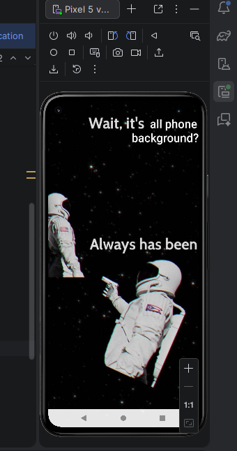
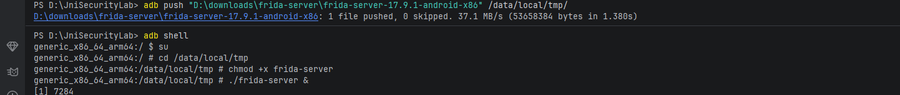
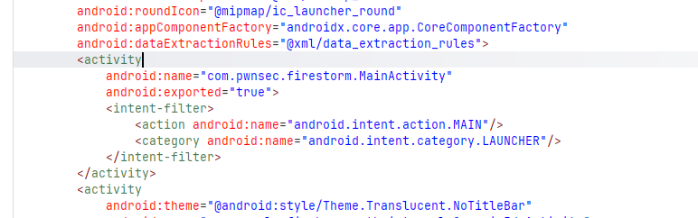
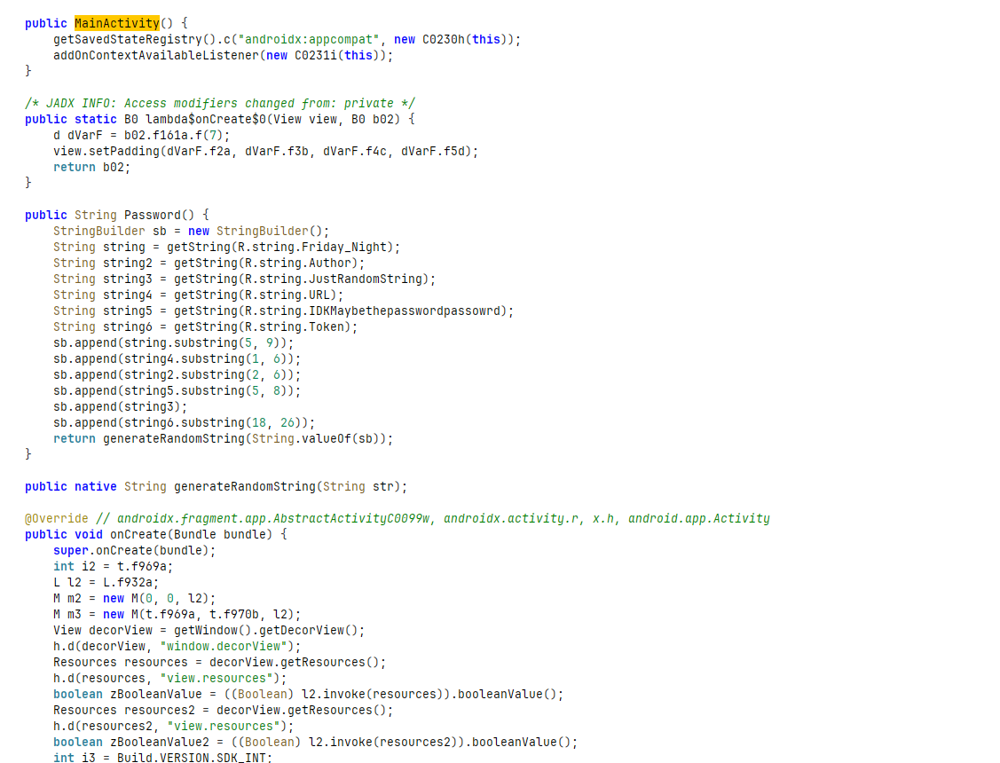
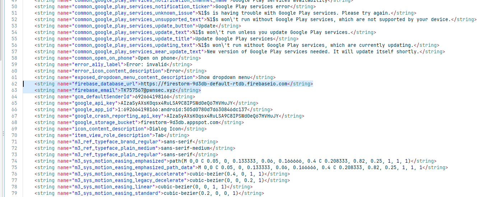
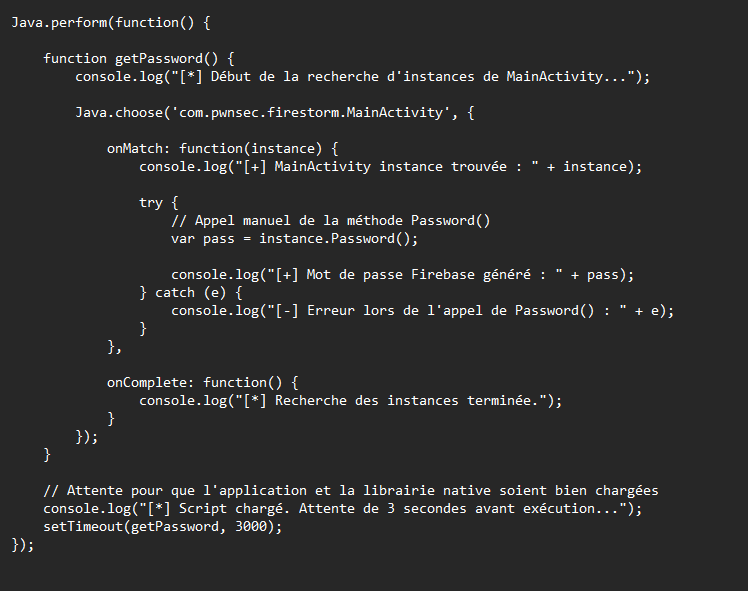
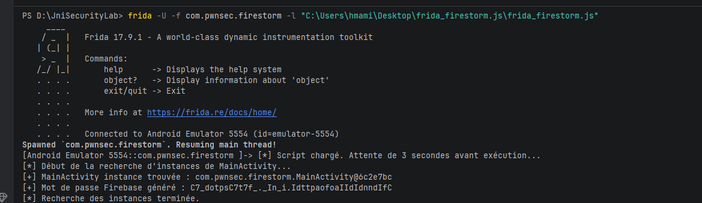
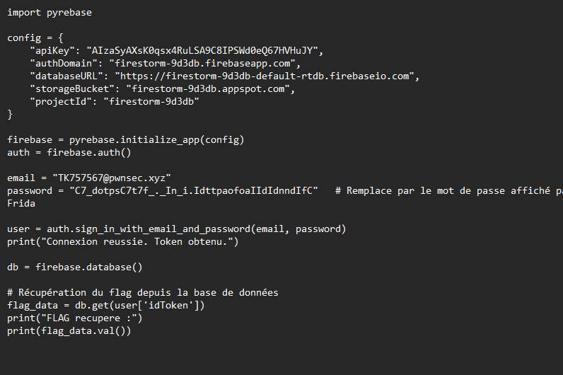
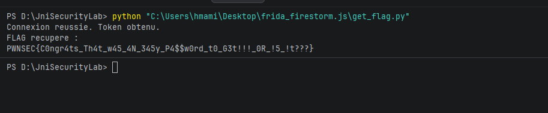

#  FireStorm - Android Reverse Engineering Challenge

##  Objectif du challenge
L'application Android `FireStorm` contient une fonction cachée qui génère un mot de passe pour se connecter à une base de données Firebase. Cette fonction n'est jamais appelée dans le flux normal de l'application. 

L'objectif de ce challenge est de :
1. Analyser statiquement l'APK pour comprendre la logique cachée.
2. Forcer l'exécution de cette fonction "morte" en utilisant **Frida** (hooking dynamique).
3. Récupérer le mot de passe généré, puis s'authentifier sur Firebase via un script externe pour obtenir le flag.

**Niveau :** Medium  
**Techniques :** Reverse Android (Jadx), Hooking dynamique (Frida), Authentification Firebase (Python/Pyrebase).

---

## Aperçu de l'application
Voici l'interface de l'application lors de son exécution normale. L'interface ne présente aucune fonctionnalité apparente liée à Firebase, ce qui confirme que la logique vulnérable est cachée "sous le capot".




---

##  Outils utilisés
* **Émulateur Android** (Pixel 5 via Android Studio / AVD)
* **ADB** (Android Debug Bridge) pour communiquer avec l'émulateur
* **Jadx-GUI** pour la décompilation et l'analyse statique du code Java
* **Frida** pour l'instrumentation dynamique en mémoire
* **Python & Pyrebase4** pour l'exploitation de la base de données Firebase

---

##  Résolution détaillée pas à pas

### Étape 1 : Préparation de l'environnement (Frida Server)
Pour pouvoir analyser et manipuler l'application pendant son exécution, nous devons établir un pont entre notre machine hôte et l'émulateur. Cela se fait en déployant `frida-server` sur l'appareil Android avec les droits root.

```bash
# Envoi du binaire frida-server sur l'appareil
adb push frida-server-17.9.1-android-x86 /data/local/tmp/

# Connexion au shell, passage en root et exécution
adb shell
su
cd /data/local/tmp
chmod +x frida-server
./frida-server &
```




---

### Étape 2 : Analyse statique avec Jadx
Nous ouvrons l'APK dans **Jadx-GUI** pour analyser son code source. 

La première étape de toute analyse Android consiste à regarder le fichier `AndroidManifest.xml`. Il nous indique que l'activité principale (celle qui se lance au démarrage) est `com.pwnsec.firestorm.MainActivity`.




En explorant le code décompilé de `MainActivity`, nous tombons sur une méthode très intéressante nommée `Password()`. 




**Analyse de la méthode `Password()` :**
1. Elle récupère plusieurs chaînes de caractères (strings) stockées dans les ressources de l'application (ex: `R.string.Friday_Night`, `R.string.Token`, etc.).
2. Elle utilise `substring()` pour extraire des morceaux spécifiques de ces chaînes et les assemble à l'aide d'un `StringBuilder`.
3. Enfin, elle passe cette chaîne assemblée à une fonction native nommée `generateRandomString(String str)`.

Le problème ? En cherchant les références croisées (cross-references) de cette méthode, on s'aperçoit qu'elle n'est **jamais appelée** par l'application. C'est du "dead code" volontairement laissé par le créateur du challenge.

Pour que notre future attaque fonctionne, nous devons également fouiller dans le fichier de ressources `res/values/strings.xml`. C'est là que nous découvrons les identifiants codés en dur nécessaires pour se connecter à Firebase : l'URL de la base de données, la clé API Google, et surtout, l'email de l'utilisateur (`TK757567@pwnsec.xyz`).




---

### Étape 3 : Hooking dynamique avec Frida
Puisque la méthode `Password()` n'est jamais exécutée, nous ne pouvons pas simplement lire le mot de passe (d'autant plus qu'il dépend d'une librairie native `generateRandomString`). 

La solution est d'utiliser **Frida** pour s'injecter dans la machine virtuelle Java de l'application en cours de route, chercher une instance active de `MainActivity`, et forcer manuellement l'exécution de la méthode `Password()`.

Voici le script JavaScript créé pour l'occasion :




**Explication du script :**
* `Java.choose('com.pwnsec.firestorm.MainActivity', ...)` : Scanne la mémoire (heap) pour trouver l'objet `MainActivity` actuellement instancié par l'application.
* `instance.Password()` : Une fois l'objet trouvé, on appelle directement la fonction dessus.
* `setTimeout(..., 3000)` : On ajoute un délai de 3 secondes pour s'assurer que l'application et sa librairie native (`libfirestorm.so`) sont complètement chargées en mémoire avant de lancer le hook.

Nous exécutons ensuite ce script via le terminal :
```bash
frida -U -f com.pwnsec.firestorm -l frida_firestorm.js
```

Bingo ! Le script s'exécute, force l'appel à la librairie native, et nous affiche le mot de passe Firebase généré.




---

### Étape 4 : Exploitation et récupération du Flag
Nous avons maintenant toutes les pièces du puzzle :
* **L'email** : `TK757567@pwnsec.xyz` (Trouvé dans `strings.xml`)
* **Le mot de passe** : `C7_dotpsC7t7f_._In_i.IdttpaofoaIIdIdnndIfC` (Obtenu via Frida)
* **La configuration Firebase** : API Key, Database URL, etc. (Trouvés dans `strings.xml`)

Nous écrivons un script en Python utilisant la librairie `pyrebase` pour simuler le comportement de l'application, nous authentifier auprès des serveurs de Google, et télécharger le contenu de la base de données pour lire le flag.




On lance le script Python. L'authentification réussit, un token est généré par Firebase, et la base de données nous renvoie le flag tant convoité !




---

##  Flag Final
```text
PWNSEC{C0ngr4ts_Th4t_w45_4N_345y_P4$$w0rd_t0_G3t!!!_0R_!5_!t???}
```

**Conclusion :** Ce laboratoire démontre l'importance de ne jamais laisser de code mort sensible (fonctions de debug, génération de mots de passe) dans une application de production, et prouve que l'obfuscation via des librairies natives (JNI/NDK) n'est pas une barrière infranchissable face à l'instrumentation dynamique avec Frida.

