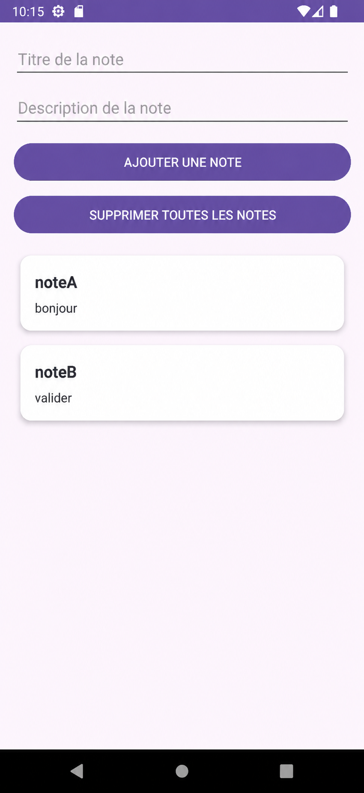
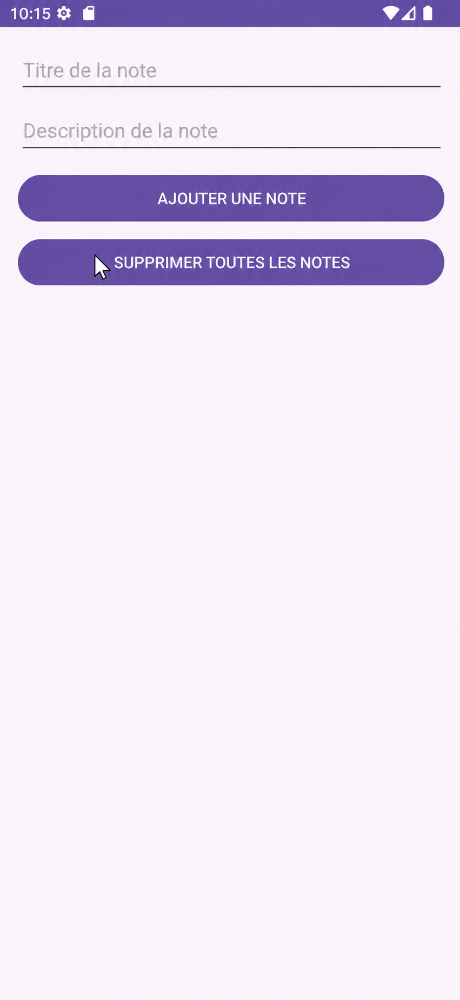

# LAB 19 : Room, MVVM, Repository, ViewModel, LiveData et RecyclerView

## Présentation du lab

Ce lab a pour objectif de créer une application Android en Java basée sur une architecture propre utilisant Room, MVVM, Repository, ViewModel, LiveData et RecyclerView.

L’application permet de gérer une liste de notes avec un titre et une description. Elle utilise une base de données locale SQLite via Room afin de sauvegarder les données directement sur le téléphone.

## Informations du lab

- Module : Programmation Mobile
- Technologie : Android avec Java
- Architecture : MVVM
- Base de données locale : Room Database
- Affichage dynamique : RecyclerView
- Gestion de l’état : ViewModel et LiveData

## Objectifs du lab

À la fin de ce lab, l’application doit permettre de :

- Ajouter une nouvelle note
- Afficher la liste des notes enregistrées
- Supprimer toutes les notes
- Sauvegarder les données localement avec Room
- Séparer correctement les couches du projet selon l’architecture MVVM

## Compétences visées

Ce lab permet de comprendre la différence entre :

- Une application codée directement dans l’Activity
- Une application structurée selon l’architecture MVVM

Il permet aussi de comprendre le rôle de chaque couche :

- Entity : représente la structure des données sauvegardées
- DAO : contient les méthodes d’accès à la base de données
- RoomDatabase : représente la base SQLite locale
- Repository : couche intermédiaire entre les données et le ViewModel
- ViewModel : contient la logique de présentation
- LiveData : permet l’observation automatique des changements
- RecyclerView : permet l’affichage dynamique de la liste des notes

## Architecture utilisée

L’application suit l’architecture MVVM :

Activity / Interface utilisateur  
↓  
ViewModel  
↓  
Repository  
↓  
DAO  
↓  
Room Database  
↓  
SQLite local

Cette organisation permet de séparer la logique métier, la logique d’affichage et l’accès aux données.

## Structure du projet

Le projet est organisé de manière claire afin de respecter l’architecture MVVM.

Exemple de structure :

app  
└── java  
    └── com.example.lab19  
        ├── MainActivity.java  
        ├── Note.java  
        ├── NoteDao.java  
        ├── NoteDatabase.java  
        ├── NoteRepository.java  
        ├── NoteViewModel.java  
        ├── NoteAdapter.java  
        └── RecyclerView Adapter

## Étapes de réalisation

### Étape 1 : Création du projet Android

Un nouveau projet Android a été créé avec Java comme langage principal.

Le projet contient une activité principale permettant d’afficher l’interface de gestion des notes.

### Étape 2 : Ajout des dépendances Room

Les dépendances nécessaires à Room ont été ajoutées dans le fichier Gradle du projet.

Room permet de gérer une base de données SQLite locale de manière plus simple et plus structurée.

### Étape 3 : Création de l’Entity

Une classe Entity a été créée pour représenter une note.

Chaque note contient généralement :

- Un identifiant unique
- Un titre
- Une description

Cette classe représente la table dans la base de données Room.

### Étape 4 : Création du DAO

Le DAO contient les méthodes utilisées pour accéder aux données.

Les opérations principales sont :

- Insérer une note
- Lire toutes les notes
- Supprimer toutes les notes

Le DAO permet de séparer les requêtes SQL du reste de l’application.

### Étape 5 : Création de la base Room

Une classe RoomDatabase a été créée pour représenter la base de données locale.

Elle permet de relier l’Entity et le DAO.

Cette classe sert de point central pour accéder à la base SQLite.

### Étape 6 : Création du Repository

Le Repository joue le rôle d’intermédiaire entre le ViewModel et le DAO.

Il permet de centraliser l’accès aux données et de garder une architecture propre.

### Étape 7 : Création du ViewModel

Le ViewModel contient la logique liée à l’interface utilisateur.

Il permet de conserver les données même après une rotation de l’écran ou une recréation de l’Activity.

Il communique avec le Repository pour ajouter, lire ou supprimer les notes.

### Étape 8 : Création de l’Adapter RecyclerView

Un Adapter RecyclerView a été créé pour afficher les notes sous forme de liste.

Chaque élément de la liste représente une note avec son titre et sa description.

### Étape 9 : Création du layout principal

Le layout principal contient :

- Un champ pour le titre de la note
- Un champ pour la description de la note
- Un bouton pour ajouter une note
- Un bouton pour supprimer toutes les notes
- Une zone d’affichage des notes

### Étape 10 : Test final de l’application

Après la réalisation de toutes les étapes, l’application a été testée sur un émulateur Android.

Les fonctionnalités principales ont été vérifiées :

- L’interface s’affiche correctement
- Le bouton d’ajout est visible
- Le bouton de suppression est visible
- Les champs de saisie sont présents
- L’application respecte la logique MVVM

## Résultat obtenu

L’application finale affiche une interface simple et fonctionnelle permettant de gérer des notes.

Elle respecte l’architecture demandée dans le lab et utilise les composants modernes d’Android.

## Captures d’écran de réalisation

Créer un dossier nommé `screenshots` dans le dépôt GitHub puis placer les deux images de réalisation dedans.

### Capture 1 : Interface principale avec curseur sur le bouton de suppression

### Capture 2 : Interface principale finale de l’application

## Explication des captures

### Capture 1

La première capture montre l’interface principale de l’application avec les deux champs de saisie :

- Titre de la note
- Description de la note

Elle montre également les deux boutons principaux :

- Ajouter une note
- Supprimer toutes les notes

Cette capture permet de vérifier que l’interface a été correctement réalisée.

### Capture 2

La deuxième capture montre le résultat final de l’interface après ajustement.

L’application est prête à être utilisée sur un émulateur Android.

## Fonctionnement de l’application

L’utilisateur saisit un titre et une description dans les champs prévus.

Lorsqu’il clique sur le bouton `AJOUTER UNE NOTE`, la note est enregistrée dans la base de données locale Room.

Les données sont ensuite observées avec LiveData et affichées automatiquement dans le RecyclerView.

Le bouton `SUPPRIMER TOUTES LES NOTES` permet de vider la liste des notes enregistrées.

## Technologies utilisées

- Java
- Android Studio
- Room Database
- SQLite
- MVVM
- Repository Pattern
- ViewModel
- LiveData
- RecyclerView
- XML Layout

## Avantages de cette architecture

L’utilisation de MVVM avec Room offre plusieurs avantages :

- Code mieux organisé
- Séparation claire des responsabilités
- Meilleure maintenabilité
- Données conservées lors des changements de configuration
- Interface automatiquement mise à jour grâce à LiveData
- Accès aux données mieux structuré avec Repository et DAO

## Conclusion

Ce lab a permis de réaliser une application Android complète de gestion de notes en utilisant une architecture propre et professionnelle.

L’utilisation de Room, ViewModel, LiveData, Repository et RecyclerView permet de construire une application plus robuste, plus claire et plus facile à maintenir.

Ce travail montre la différence entre une application simple codée directement dans l’Activity et une application bien structurée selon l’architecture MVVM.

