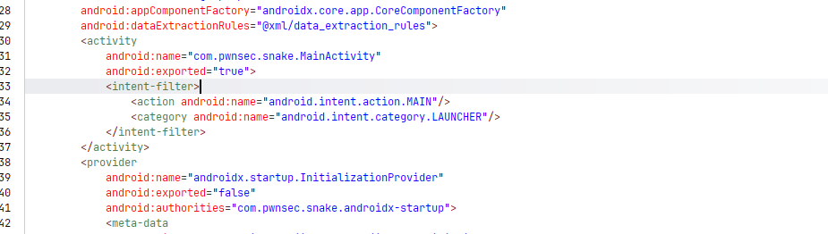
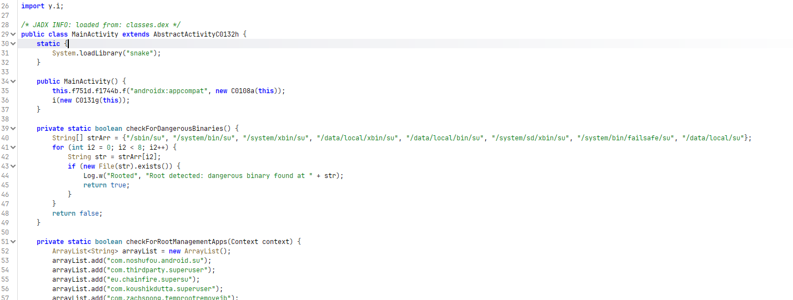
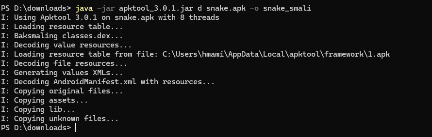
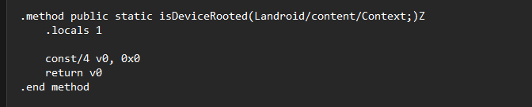
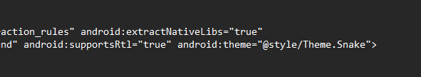
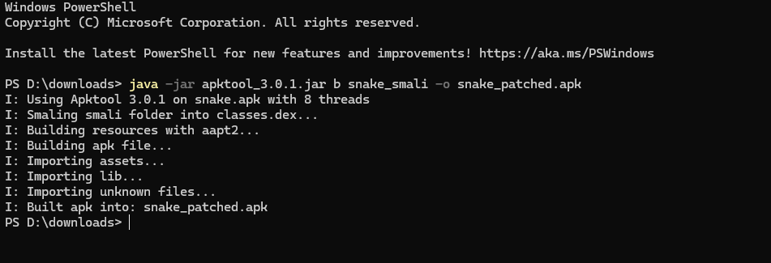
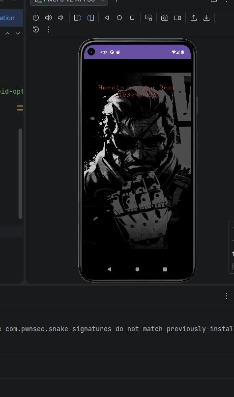
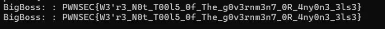

#  Snake — Android Reverse Engineering Challenge

##  Objectif du challenge

L'application Android `Snake` est un défi de sécurité complexe intégrant des protections anti-root et anti-analyse. Le but est d'exploiter une vulnérabilité de désérialisation non sécurisée (**SnakeYAML**) pour forcer l'instanciation d'une classe cachée qui interagit avec une librairie native (JNI) pour générer un flag.

**Objectifs :**
1. **Analyser statiquement** l'APK pour identifier les verrous de sécurité.
2. **Décompiler et patcher** le code Smali pour bypasser la détection de Root.
3. **Modifier le Manifest** pour autoriser l'extraction des librairies natives.
4. **Exploiter la vulnérabilité** CVE-2022-1471 via un payload YAML.
5. **Récupérer le flag** final dans les journaux système (Logcat).

**Niveau :** Medium / Hard  
**Techniques :** Reverse Android (Jadx), Patching Smali (Apktool), Insecure Deserialization (SnakeYAML), Analyse JNI

---

##  Outils utilisés

| Outil | Usage |
|-------|-------|
| Émulateur Android (Pixel 5 API 30) | Environnement d'exécution |
| ADB (Android Debug Bridge) | Commandes shell et Logcat |
| Jadx-GUI | Analyse du code Java décompilé |
| Apktool | Décompilation et reconstruction de l'APK |
| Jarsigner & Zipalign | Signature et optimisation |

---

##  1. Analyse Statique & Identification

L'analyse initiale via **Jadx-GUI** révèle que la `MainActivity` est exportée (`android:exported="true"`), ce qui la rend vulnérable à des appels d'Intents externes.




En approfondissant le code Java, on découvre la fonction `checkForDangerousBinaries`, chargée de détecter si l'appareil est rooté en cherchant des binaires comme `/system/bin/su`.




---

##  2. Patching et Bypass des Protections

### 2.1 Décompilation avec Apktool

Pour contourner les protections, nous décompilons l'APK avec **Apktool** afin d'accéder aux fichiers de bytecode Smali.

```bash
java -jar apktool_3.0.1.jar d snake.apk -o snake_smali
```




### 2.2 Patch du bytecode Smali

Nous localisons et patchons la méthode `isDeviceRooted` dans le fichier Smali pour qu'elle renvoie systématiquement `false` (`0x0`), neutralisant ainsi toute sécurité anti-root.




---

##  3. Modification du Manifest et Reconstruction

Pour que les librairies natives JNI (`.so`) fonctionnent correctement sur les versions récentes d'Android après modification, nous patchons le Manifest en ajoutant l'attribut `android:extractNativeLibs="true"`.




Nous reconstruisons ensuite l'APK modifiée :

```bash
java -jar apktool_3.0.1.jar b snake_smali -o snake_patched.apk
```




Le fichier `snake_patched.apk` est généré avec succès.


---

## 4. Exploitation et Capture du Flag

### 4.1 Payload YAML (CVE-2022-1471)

Le challenge utilise la bibliothèque **SnakeYAML**. Nous créons un fichier `Skull_Face.yml` utilisant un *Global Tag* pour forcer l'instanciation de la classe `BigBoss` :

```yaml
!!com.pwnsec.snake.BigBoss ["Snaaaaaaaaaaaaaaake"]
```

### 4.2 Déclenchement de l'exploit via ADB

```bash
# Préparation de l'environnement
adb shell mkdir -p /sdcard/snake
adb push Skull_Face.yml /sdcard/snake/Skull_Face.yml
adb shell pm grant com.pwnsec.snake android.permission.READ_EXTERNAL_STORAGE

# Lancement de l'exploit
adb shell am start -n com.pwnsec.snake/.MainActivity -e SNAKE BigBoss
```

L'instanciation de la classe `BigBoss` déclenche l'appel JNI vers la fonction native. L'image de *Big Boss* dans l'émulateur confirme que la logique vulnérable a bien été activée.




### 4.3 Récupération du flag via Logcat

En filtrant les logs système avec le tag `BigBoss`, nous récupérons le flag :




```
PWNSEC{W3'r3_N0t_T00l5_0f_The_g0v3rnm3n7_0R_4ny0n3_3ls3}
```

---

## Conclusion

Ce laboratoire démontre qu'une protection logicielle peut être contournée par du **patching statique** au niveau du bytecode Smali. L'exploitation de la désérialisation YAML (CVE-2022-1471) prouve que des entrées non sécurisées peuvent mener à l'exécution de code caché dans les couches natives de l'application.

> **Key Takeaways :**
> - `android:exported="true"` expose les Activities à des Intents externes malveillants.
> - Les protections anti-root basées sur des vérifications de fichiers sont trivialement contournables par patching Smali.
> - L'utilisation de SnakeYAML sans validation des tags permet une instanciation arbitraire de classes (gadget chain).

