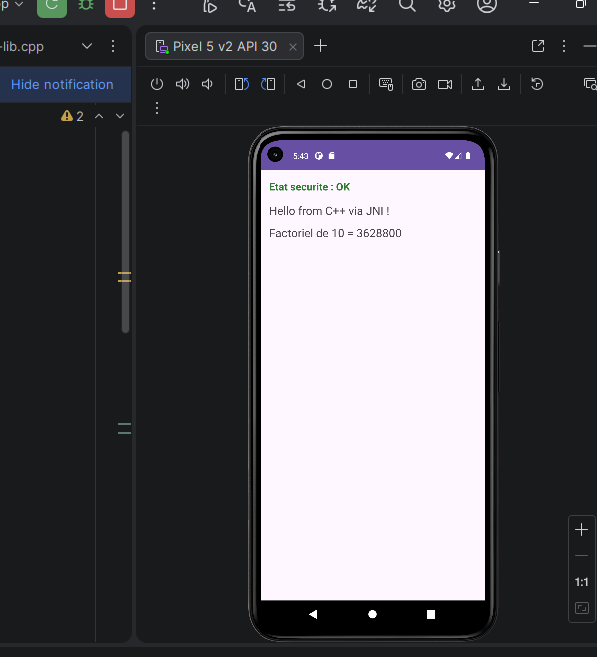
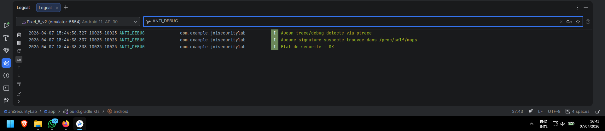

# 🔒 Android JNI Lab — Détection d’Environnement Suspect (Anti-Debug)

## 📌 Description du projet

Ce projet Android met en œuvre une **approche de sécurité défensive** en utilisant du code natif C++ via **JNI (Java Native Interface)**.

L’objectif est de détecter si l’application est exécutée dans un environnement potentiellement dangereux (debugger, instrumentation, outils de reverse engineering) et d’adapter dynamiquement son comportement.

---

## ⚙️ Principe de fonctionnement

L’application repose sur une architecture hybride :

```text
Interface Android (Java)
        ↓
Appel JNI
        ↓
Code natif C++ (détection sécurité)
```

👉 Le code C++ réalise les contrôles sensibles
👉 Java affiche le résultat et adapte l’interface

---

## 🔍 Mécanismes de détection implémentés

### 🧩 1. Détection de debugger avec `ptrace`

```cpp
long result = ptrace(PTRACE_TRACEME, 0, 0, 0);
if (result == -1) {
    // Debug détecté
}
```

✔️ Si un debugger est attaché → la fonction échoue
✔️ Cela indique que l’application est surveillée

---

### 🧩 2. Analyse mémoire via `/proc/self/maps`

```cpp
FILE* maps = fopen("/proc/self/maps", "r");
```

Chaque ligne du fichier est analysée :

```cpp
if (strstr(line, "frida") ||
    strstr(line, "xposed") ||
    strstr(line, "magisk") ||
    strstr(line, "gdb")) {
    // Outil suspect détecté
}
```

✔️ Permet de détecter :

* Frida
* Xposed
* Magisk
* Outils de debug

---

## 🧠 Logique de sécurité

Le cœur du système est :

```cpp
bool traced = isBeingTraced();
bool suspicious = containsSuspiciousLibraryNames();

if (traced || suspicious) {
    return JNI_TRUE;
} else {
    return JNI_FALSE;
}
```

👉 Si un seul signal est détecté → environnement suspect

---

## 📱 Comportement côté Android (Java)

```java
boolean suspicious = isDebugDetected();

if (suspicious) {
    // Bloquer fonctionnalités sensibles
} else {
    // Exécution normale
}
```

✔️ L’application ne crash pas
✔️ Elle adopte un comportement sécurisé

---

## 📸 Résultats obtenus

### 🔹 Screenshot 1 — Exécution normale

📂 Chemin : `screenshots/app_ok.png`




📝 Analyse :

* L’application affiche **"Etat sécurité : OK"**
* Les fonctions natives sont actives :

  * Message C++ affiché
  * Calcul du factoriel effectué
* Aucun environnement suspect détecté

---

### 🔹 Screenshot 2 — Logcat (Analyse interne)

📂 Chemin : `screenshots/logcat_ok.png`




📝 Analyse des logs :

```text
Aucun trace/debug detecte via ptrace
Aucune signature suspecte trouvee dans /proc/self/maps
Etat de securite : OK
```

✔️ Aucun debugger détecté
✔️ Aucun outil d’instrumentation trouvé
✔️ Le système valide un environnement sain

---

## 💡 Apports du code natif (C++)

* Accès bas niveau au système
* Difficulté accrue pour le reverse engineering
* Possibilité d’implémenter des contrôles invisibles côté Java
* Meilleure protection contre l’analyse dynamique

---

## ⚠️ Limites de l’approche

* Détection non fiable à 100%
* Faux positifs possibles (ex: debug Android Studio)
* Peut être contournée par des attaquants expérimentés

---

## 📌 Conclusion

Ce projet démontre comment combiner **Java et C++** pour implémenter des mécanismes de sécurité dans une application Android.

L’utilisation du code natif permet de renforcer la protection en déléguant les contrôles critiques à un niveau plus bas, rendant l’analyse et le contournement plus complexes.

---

