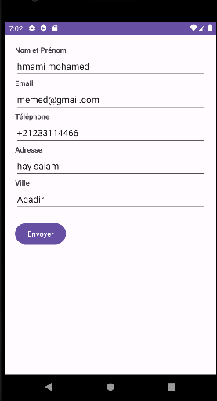
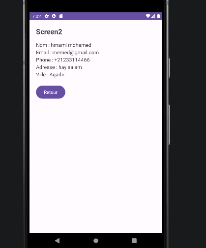

Screen 1 – Formulaire

Le premier écran contient un formulaire permettant à l’utilisateur de saisir ses informations personnelles :
Nom et prénom
Email
Téléphone
Adresse
Ville
Après avoir rempli les champs, l’utilisateur clique sur le bouton "Envoyer" pour transmettre les données au deuxième écran.

Screen 2 – Récapitulatif

Le deuxième écran affiche un résumé des informations saisies dans le formulaire.
Un bouton "Retour" permet de revenir au premier écran.

