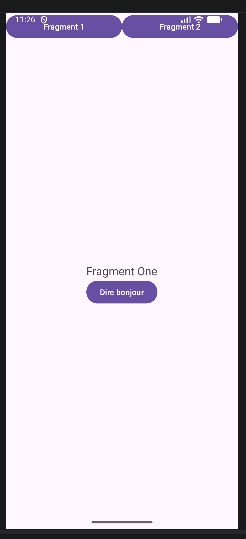
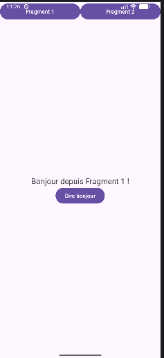
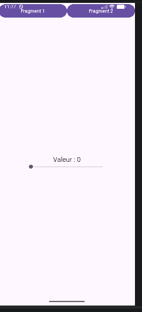
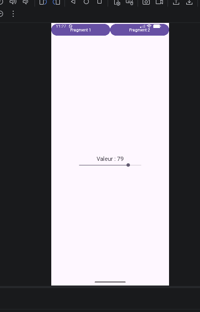

# FragmentsLab

Application Android simple réalisée avec **Kotlin** pour apprendre à utiliser les **Fragments** dans une activité.

## Objectif du projet

Ce lab a pour but de comprendre :

* la création et l’utilisation de **fragments dynamiques**
* la navigation entre plusieurs fragments
* la gestion des événements dans chaque fragment
* la conservation d’un état simple (valeur du `SeekBar`)

## Fonctionnalités

L’application contient :

* une **activité principale** avec deux boutons en haut :

  * **Fragment 1**
  * **Fragment 2**
* un **conteneur dynamique** (`FrameLayout`) qui affiche les fragments

### Fragment 1

Le premier fragment affiche :

* un texte : **Fragment One**
* un bouton : **Dire bonjour**

Quand on clique sur le bouton, le texte devient :

**Bonjour depuis Fragment 1 !**

### Fragment 2

Le deuxième fragment affiche :

* un texte : **Valeur : 0**
* un **SeekBar**

Quand on déplace le `SeekBar`, la valeur affichée change dynamiquement.

Exemple :

* **Valeur : 79**

## Captures d’écran

### 1. Affichage initial du Fragment 1

### 2. Après clic sur le bouton "Dire bonjour"

### 3. Affichage initial du Fragment 2

### 4. Fragment 2 après déplacement du SeekBar

## Structure du projet

### Fichiers Kotlin

* `MainActivity.kt`
* `FragmentOne.kt`
* `FragmentTwo.kt`

### Layouts XML

* `activity_main.xml`
* `fragment_one.xml`
* `fragment_two.xml`

## Fonctionnement

* `MainActivity` gère l’affichage des fragments
* au démarrage, **Fragment 1** est affiché
* le clic sur **Fragment 1** ou **Fragment 2** remplace le contenu du conteneur
* `FragmentOne` gère un clic sur bouton
* `FragmentTwo` gère les changements du `SeekBar`

## Technologies utilisées

* **Android Studio**
* **Kotlin**
* **AndroidX Fragments**
* **XML** pour les interfaces

## Résultat

Ce projet montre comment :

* créer une interface modulaire avec des fragments
* interagir avec des composants graphiques
* changer dynamiquement de contenu dans une activité

---

