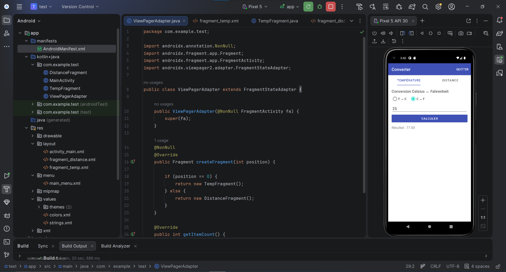
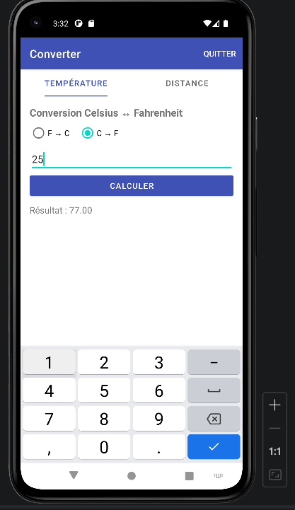
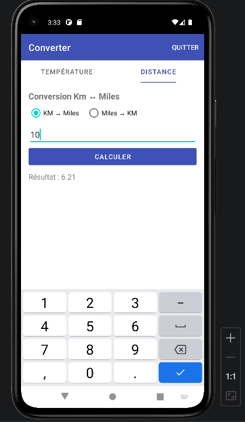
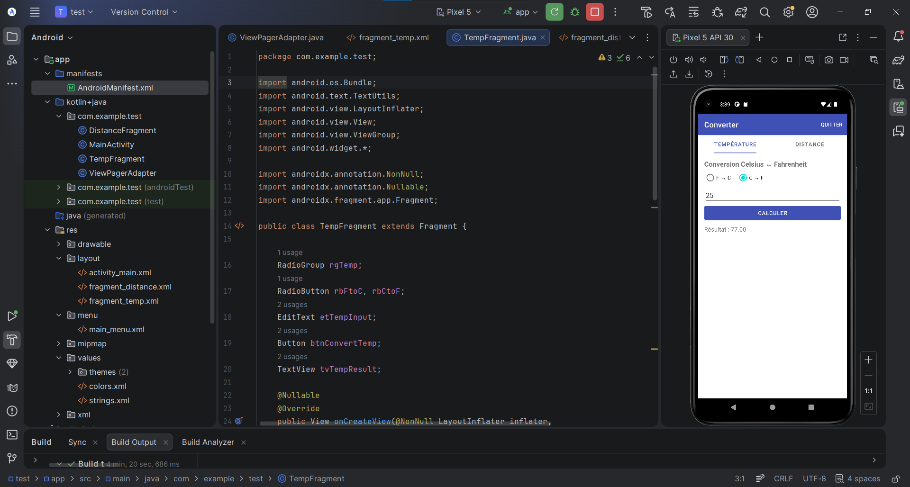
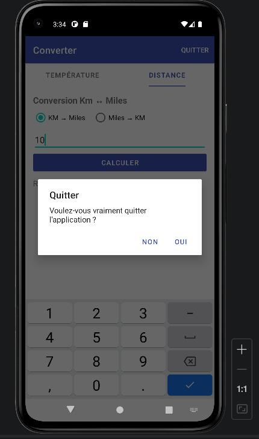

# README — Lab Android : Application de Conversion avec Java

## 1. Présentation

Ce projet est une application Android développée en **Java** sous **Android Studio**.  
Elle permet à l’utilisateur d’effectuer deux conversions simples à partir d’une interface composée de deux onglets :

- Conversion de température : Celsius ↔ Fahrenheit
- Conversion de distance : Kilomètres ↔ Miles

L’application contient également une option **Quitter** dans la barre supérieure. Cette option affiche une boîte de dialogue de confirmation avant de fermer l’application.

---

## 2. Objectifs du projet

Ce lab a pour objectif de mettre en pratique plusieurs notions importantes du développement Android :

- Créer une application Android en Java.
- Utiliser une activité principale.
- Créer et gérer plusieurs fragments.
- Ajouter une navigation par onglets.
- Utiliser `TabLayout` et `ViewPager2`.
- Créer des interfaces XML.
- Ajouter un menu dans la barre supérieure.
- Afficher une boîte de dialogue avec `AlertDialog`.

---

## 3. Environnement utilisé

Le projet a été réalisé avec :

- Android Studio
- Java
- XML
- Gradle Kotlin DSL
- Android SDK API 35
- Émulateur Pixel 5 API 30
- AppCompat
- Material Components
- ViewPager2

---

## 4. Dépendances ajoutées

Les dépendances utilisées dans le fichier `build.gradle.kts (Module : app)` sont :

    implementation("androidx.appcompat:appcompat:1.7.0")
    implementation("com.google.android.material:material:1.12.0")
    implementation("androidx.viewpager2:viewpager2:1.1.0")

`appcompat` permet d’utiliser `AppCompatActivity` et `AlertDialog`.

`material` permet d’utiliser le composant `TabLayout`.

`viewpager2` permet de gérer l’affichage des fragments dans les onglets.

---

## 5. Organisation des fichiers

Le projet contient plusieurs fichiers Java et XML organisés comme suit :

    app
     └── src
         └── main
             ├── java
             │   └── com.example.test
             │       ├── MainActivity.java
             │       ├── ViewPagerAdapter.java
             │       ├── TempFragment.java
             │       └── DistanceFragment.java
             │
             ├── res
             │   ├── layout
             │   │   ├── activity_main.xml
             │   │   ├── fragment_temp.xml
             │   │   └── fragment_distance.xml
             │   │
             │   ├── menu
             │   │   └── main_menu.xml
             │   │
             │   └── values
             │       ├── colors.xml
             │       ├── strings.xml
             │       └── themes.xml
             │
             └── AndroidManifest.xml

La capture suivante montre l’organisation du projet dans Android Studio :

---

## 6. Description des composants

### MainActivity.java

`MainActivity.java` est la classe principale de l’application.  
Elle permet de lancer l’interface, de gérer les onglets et d’afficher le menu **Quitter**.

Elle contient aussi la fonction qui affiche la boîte de dialogue lorsque l’utilisateur veut fermer l’application.

---

### ViewPagerAdapter.java

`ViewPagerAdapter.java` sert à connecter les fragments avec le `ViewPager2`.

Il permet d’afficher :

- `TempFragment` dans le premier onglet.
- `DistanceFragment` dans le deuxième onglet.

Grâce à cet adaptateur, chaque onglet affiche le bon contenu.

---

### TempFragment.java

`TempFragment.java` gère la conversion de température.

Deux choix sont proposés :

- Fahrenheit vers Celsius
- Celsius vers Fahrenheit

Les formules utilisées sont :

    F = 1.8 × C + 32

    C = (F - 32) / 1.8

L’utilisateur saisit une valeur, choisit le sens de conversion, puis clique sur **CALCULER**.

---

### DistanceFragment.java

`DistanceFragment.java` gère la conversion de distance.

Deux choix sont proposés :

- Kilomètres vers Miles
- Miles vers Kilomètres

Les formules utilisées sont :

    Miles = Km × 0.6214

    Km = Miles / 0.6214

Le résultat est affiché directement après le clic sur le bouton **CALCULER**.

---

### activity_main.xml

Ce fichier contient l’interface principale de l’application.

Il contient :

- Un `TabLayout` pour afficher les onglets.
- Un `ViewPager2` pour afficher les fragments.

---

### fragment_temp.xml

Ce fichier contient l’interface de l’onglet température.

Il contient :

- Un titre.
- Deux boutons radio.
- Une zone de saisie.
- Un bouton de calcul.
- Une zone de résultat.

---

### fragment_distance.xml

Ce fichier contient l’interface de l’onglet distance.

Il contient :

- Un titre.
- Deux boutons radio.
- Une zone de saisie.
- Un bouton de calcul.
- Une zone de résultat.

---

### main_menu.xml

Ce fichier contient le menu de l’application.

Il ajoute le bouton suivant dans la barre supérieure :

    Quitter

Ce bouton permet de demander une confirmation avant la fermeture de l’application.

---

### themes.xml

Ce fichier définit le thème graphique de l’application.

Un thème avec `ActionBar` a été utilisé afin d’afficher la barre supérieure avec le titre **Converter** et le bouton **Quitter**.

---

### AndroidManifest.xml

Ce fichier déclare les informations principales de l’application, notamment :

- L’activité principale.
- Le thème utilisé.
- Le nom de l’application.
- L’icône de l’application.

---

## 7. Fonctionnement de l’application

Au démarrage, l’application affiche une interface contenant deux onglets :

- **TEMPÉRATURE**
- **DISTANCE**

L’utilisateur peut passer d’un onglet à l’autre, saisir une valeur, choisir le type de conversion et cliquer sur **CALCULER**.

Le résultat est ensuite affiché dans la même page.

---

## 8. Test de l’onglet Température

Le test suivant a été réalisé :

- Onglet sélectionné : Température
- Conversion choisie : C → F
- Valeur saisie : 25

Résultat obtenu :

    Résultat : 77.00

Ce test montre que la conversion de Celsius vers Fahrenheit fonctionne correctement.

---

## 9. Test de l’onglet Distance

Le test suivant a été réalisé :

- Onglet sélectionné : Distance
- Conversion choisie : KM → Miles
- Valeur saisie : 10

Résultat obtenu :

    Résultat : 6.21

Ce test confirme que la conversion de kilomètres vers miles donne le bon résultat.

---

## 10. Test de la fermeture de l’application

L’application possède un bouton **Quitter** dans la barre supérieure.

Lorsqu’on clique sur ce bouton, une boîte de dialogue apparaît avec le message :

    Voulez-vous vraiment quitter l'application ?

Deux boutons sont disponibles :

- **NON** : permet d’annuler la fermeture.
- **OUI** : permet de quitter l’application.

La capture suivante montre l’application lancée dans Android Studio :

La capture suivante montre la boîte de dialogue de confirmation :

---

## 11. Résultats validés

Après les tests, les fonctionnalités suivantes ont été validées :

- L’application démarre correctement.
- Les deux onglets s’affichent.
- Le passage entre les onglets fonctionne.
- Le calcul de température fonctionne.
- Le calcul de distance fonctionne.
- Le résultat s’affiche correctement.
- Le bouton **Quitter** est visible.
- La confirmation de sortie fonctionne.
- Le bouton **NON** garde l’application ouverte.
- Le bouton **OUI** ferme l’application.

---

## 12. Problèmes rencontrés

Pendant la réalisation du lab, quelques problèmes ont été corrigés.

Le premier problème concernait la version du SDK.  
L’utilisation de `compileSdk = 36` a provoqué une erreur Gradle.  
La solution a été de travailler avec :

    compileSdk = 35
    targetSdk = 35

Le deuxième problème concernait le thème.  
Le thème initial ne permettait pas d’afficher la barre supérieure.  
La solution a été d’utiliser un thème avec `ActionBar`.

Le troisième problème concernait l’emplacement des fichiers Java.  
Tous les fichiers Java devaient être placés dans :

    com.example.test

---

## 13. Conclusion

Ce lab a permis de réaliser une application Android fonctionnelle en Java.

L’application utilise une structure simple composée d’une activité principale, de deux fragments et d’un système d’onglets.

Le convertisseur de température et le convertisseur de distance fonctionnent correctement.  
L’ajout du bouton **Quitter** avec une boîte de confirmation rend l’application plus complète.

Ce projet permet donc de mieux comprendre l’utilisation des fragments, des onglets, des interfaces XML et des menus dans une application Android.

