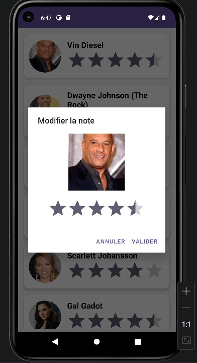
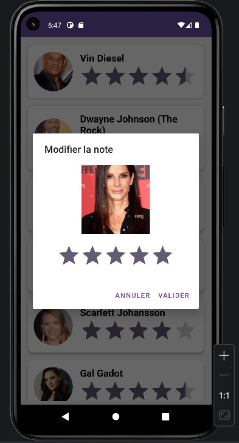

# Android Stars Rating Gallery

## Présentation

Android Stars Rating Gallery est une application Android développée en Java.

Le but de ce projet est de créer une petite galerie interactive d'acteurs et d'actrices. Chaque élément de la galerie contient une image, un nom et une note. L'utilisateur peut modifier la note grâce à une fenêtre popup personnalisée.

Ce projet permet de pratiquer les bases importantes du développement Android avec Java.

## Objectifs du lab

Ce lab permet de comprendre et d'utiliser :

- les activités Android ;
- les layouts XML ;
- le RecyclerView ;
- l'adapter personnalisé ;
- les modèles de données ;
- l'interface DAO ;
- la couche service ;
- les images locales dans drawable ;
- le SearchView ;
- le menu Android ;
- le partage avec Intent ;
- le popup avec AlertDialog ;
- la modification dynamique d'une note.

## Fonctionnement général

Au démarrage, l'application affiche un SplashScreen animé.

Après quelques secondes, l'utilisateur est dirigé vers l'écran principal. Cet écran contient une liste de stars affichées avec un RecyclerView.

Chaque ligne contient :

- une image circulaire ;
- le nom de la star ;
- une note avec des étoiles.

Lorsque l'utilisateur clique sur une star, un popup apparaît. Ce popup permet de modifier la note de la star sélectionnée.

## Architecture du projet

Le projet est organisé en plusieurs packages pour séparer les responsabilités.

    com.example.starsgallery
    │
    ├── adapter
    │   └── StarAdapter.java
    │
    ├── beans
    │   └── Star.java
    │
    ├── dao
    │   └── IDao.java
    │
    ├── service
    │   └── StarService.java
    │
    ├── ui
    │   ├── SplashActivity.java
    │   └── ListActivity.java
    │
    └── MainActivity.java

## Organisation des ressources

Les fichiers XML et les images sont placés dans le dossier res.

    app/src/main/res
    │
    ├── drawable
    │   ├── img1.png
    │   ├── img2.png
    │   ├── img3.png
    │   ├── img4.png
    │   ├── img5.png
    │   └── img6.png
    │
    ├── layout
    │   ├── activity_main.xml
    │   ├── activity_splash.xml
    │   ├── activity_list.xml
    │   ├── star_item.xml
    │   └── star_edit_item.xml
    │
    ├── menu
    │   └── menu.xml
    │
    └── values
        ├── colors.xml
        ├── strings.xml
        └── themes.xml

## Emplacement exact des images de l'application

Les images des acteurs doivent être placées dans le dossier :

    app/src/main/res/drawable/

Correspondance des images utilisées :

    img1.png  : première image utilisée dans la liste
    img2.png  : deuxième image utilisée dans la liste
    img3.png  : troisième image utilisée dans la liste
    img4.png  : quatrième image utilisée dans la liste
    img5.png  : cinquième image utilisée dans la liste
    img6.png  : sixième image utilisée dans la liste

Dans ce projet, l'ordre utilisé est :

    img1.png  : Vin Diesel
    img2.png  : Dwayne Johnson
    img3.png  : Paul Walker
    img4.png  : Sandra Bullock
    img5.png  : Scarlett Johansson
    img6.png  : Gal Gadot

Les images sont appelées dans StarService.java avec ce format :

    android.resource://com.example.starsgallery/drawable/img1
    android.resource://com.example.starsgallery/drawable/img2
    android.resource://com.example.starsgallery/drawable/img3
    android.resource://com.example.starsgallery/drawable/img4
    android.resource://com.example.starsgallery/drawable/img5
    android.resource://com.example.starsgallery/drawable/img6

Il ne faut pas écrire l'extension .png dans le code Java.

## Emplacement des captures d'écran pour GitHub

Pour ajouter les captures dans le README, créer le dossier suivant à la racine du projet :

    docs/screens/

Puis placer les captures comme ceci :

    docs/screens/home.png
    docs/screens/edit_popup_1.png
    docs/screens/edit_popup_2.png

Ces captures sont ensuite affichées dans le README avec les liens suivants :

    
    
    

## Captures d'écran

## Écran principal

## Popup de modification

## Deuxième exemple de popup

## Description des fichiers Java

## Star.java

Star.java est la classe modèle.

Elle contient les attributs suivants :

- id ;
- name ;
- img ;
- rating.

Cette classe représente une seule star dans l'application.

## IDao.java

IDao.java est une interface générique.

Elle définit les opérations de base :

- ajouter un objet ;
- modifier un objet ;
- supprimer un objet ;
- chercher un objet par id ;
- afficher tous les objets.

Cette interface rend le projet plus organisé.

## StarService.java

StarService.java contient les données de l'application.

Cette classe crée la liste des stars au démarrage. Elle permet aussi de modifier une star, de rechercher une star et de retourner toute la liste.

Elle joue le rôle de couche service entre le modèle et l'interface graphique.

## StarAdapter.java

StarAdapter.java permet d'afficher les stars dans le RecyclerView.

Il contrôle l'affichage de chaque élément de la liste.

Il est aussi responsable de :

- charger les images ;
- afficher les noms ;
- afficher les notes ;
- filtrer les résultats de recherche ;
- gérer le clic sur une star ;
- afficher le popup de modification.

## SplashActivity.java

SplashActivity.java est la première activité lancée par l'application.

Elle affiche une image avec une animation, puis redirige l'utilisateur vers ListActivity.

Les animations utilisées sont :

- rotation ;
- réduction de taille ;
- déplacement vertical ;
- disparition progressive.

## ListActivity.java

ListActivity.java est l'écran principal.

Elle configure le RecyclerView, charge l'adapter et ajoute le menu de recherche et de partage.

## Description des fichiers XML

## activity_splash.xml

Ce fichier définit l'interface de l'écran de démarrage.

Il contient une ImageView centrée.

## activity_list.xml

Ce fichier contient le RecyclerView principal.

Il sert à afficher toute la liste des stars.

## star_item.xml

Ce fichier définit le design d'une ligne dans la liste.

Il contient :

- une CircleImageView ;
- un TextView ;
- une RatingBar.

## star_edit_item.xml

Ce fichier définit le design du popup.

Il contient :

- une ImageView ;
- une RatingBar modifiable.

## menu.xml

Ce fichier définit le menu de l'application.

Il contient :

- une action de recherche ;
- une action de partage.

## Dépendances principales

Le projet utilise les bibliothèques suivantes :

    implementation("androidx.appcompat:appcompat:1.7.0")
    implementation("com.google.android.material:material:1.12.0")
    implementation("androidx.constraintlayout:constraintlayout:2.2.0")
    implementation("androidx.recyclerview:recyclerview:1.3.2")
    implementation("androidx.cardview:cardview:1.0.0")
    implementation("de.hdodenhof:circleimageview:3.1.0")
    implementation("com.github.bumptech.glide:glide:4.16.0")
    annotationProcessor("com.github.bumptech.glide:compiler:4.16.0")

## Étapes pour exécuter le projet

1. Télécharger ou cloner le projet.
2. Ouvrir le projet avec Android Studio.
3. Vérifier que les images img1.png à img6.png sont dans :

       app/src/main/res/drawable/

4. Vérifier que les layouts XML sont dans :

       app/src/main/res/layout/

5. Vérifier que le menu est dans :

       app/src/main/res/menu/menu.xml

6. Synchroniser le projet avec Gradle.
7. Lancer l'application sur un émulateur Android.
8. Tester la liste, la recherche, le partage et la modification de note.

## Résultat final

L'application affiche une galerie de stars avec une interface simple et interactive.

L'utilisateur peut consulter les stars, rechercher un nom, partager l'application et modifier la note d'une star.

## Conclusion

Ce projet met en pratique plusieurs composants essentiels d'Android Java.

Il montre comment organiser un projet, afficher des données dans un RecyclerView, utiliser des images locales, gérer un menu et créer une fenêtre popup personnalisée.

## Réalisé avec

- Android Studio
- Java
- XML
- Gradle

