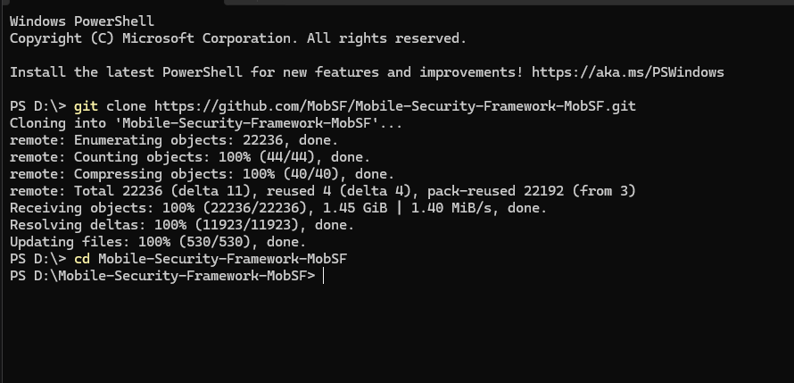
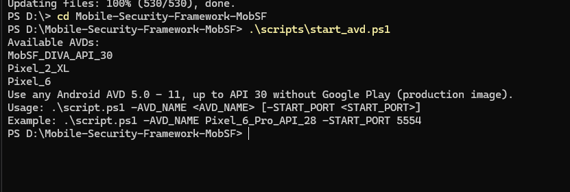
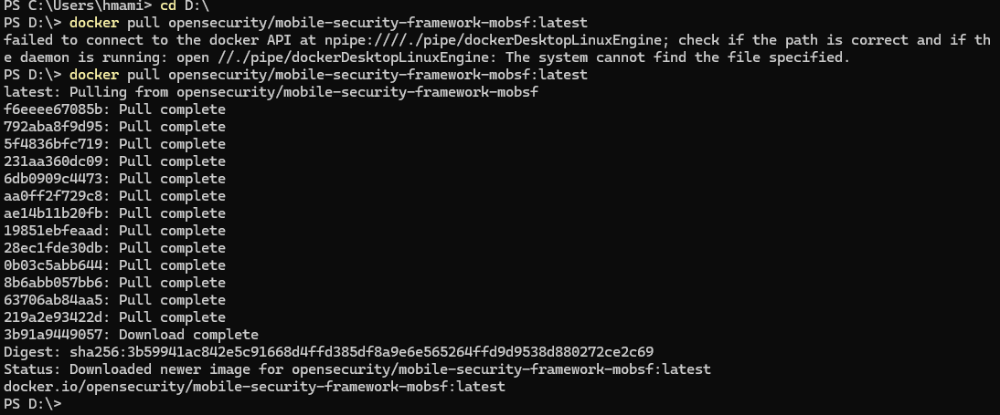
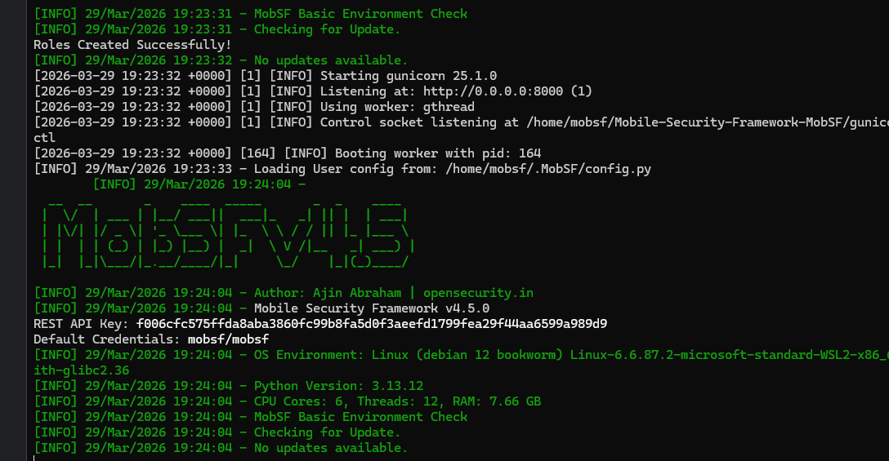
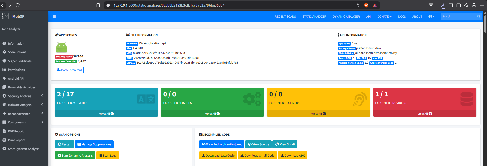
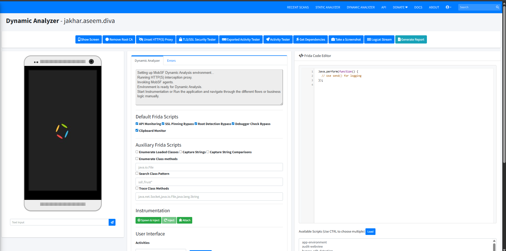
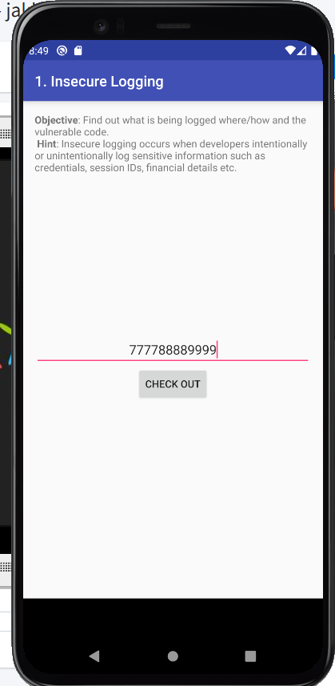
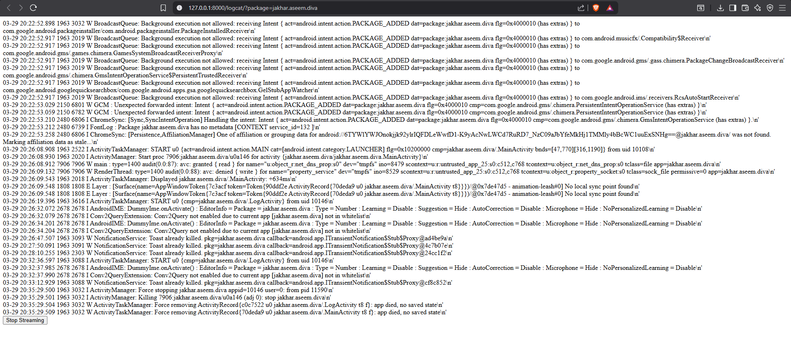
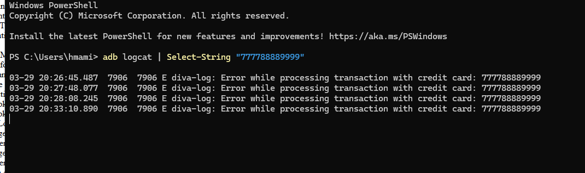
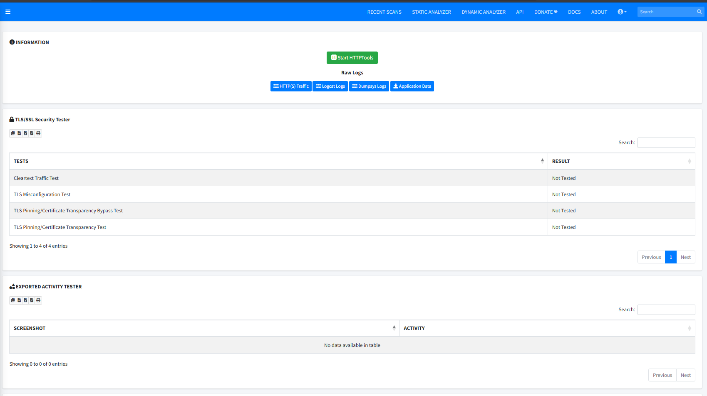

#  Lab 7 de Sécurité Mobile : Pentesting DIVA avec MobSF

Ce dépôt documente la mise en place d'un environnement de test d'intrusion mobile complet et l'analyse de l'application vulnérable **DIVA (Damn Insecure and Vulnerable App)**. L'objectif est d'identifier et d'exploiter des failles critiques en utilisant des méthodes d'analyse statique et dynamique.

---

##  Stack Technique & Outils
* **MobSF (Mobile Security Framework) :** Plateforme automatisée pour l'analyse de malwares et les tests d'intrusion.
* **Docker :** Conteneurisation du serveur MobSF pour un déploiement rapide.
* **Android Studio (AVD) :** Émulateur Android configuré sur l'**API 29** pour une compatibilité optimale avec Frida.
* **ADB (Android Debug Bridge) :** Outil de ligne de commande pour communiquer avec l'émulateur.

---

##  Étapes de Réalisation

### Phase 1 : Préparation de l'Environnement
La première étape consiste à préparer les outils sur la machine locale. Nous avons cloné le dépôt MobSF pour accéder aux scripts nécessaires à la communication avec l'émulateur.

> **Description :** Récupération des sources du projet MobSF depuis GitHub. Cela permet de disposer des scripts de démarrage (`start_avd.ps1`) indispensables pour lier Docker à l'émulateur Android.

> **Description :** Listing des terminaux virtuels créés dans Android Studio. Pour ce lab, nous avons opté pour une image **x86_64 (API 29)** afin de garantir une injection stable des scripts de sécurité.

---

### Phase 2 : Déploiement via Docker
MobSF est déployé via Docker, ce qui permet d'isoler l'outil d'analyse et de gérer facilement ses nombreuses dépendances (Python, Java, etc.).

> **Description :** Téléchargement de l'image officielle `opensecurity/mobile-security-framework-mobsf`. Cette méthode garantit que nous travaillons sur la version la plus stable et sécurisée de l'outil.

> **Description :** Lancement réussi du serveur MobSF. Le terminal affiche le logo ASCII, confirmant que l'interface web est accessible sur le port 8000.

---

### Phase 3 : Analyse Statique (SAST)
L'application **DivaApplication.apk** est soumise à un premier scan "à froid". MobSF décompile l'APK pour analyser le code source et le fichier manifeste.

> **Description :** Le tableau de bord affiche un score de sécurité de **36/100**. L'analyse révèle des permissions excessives et plusieurs activités "Exported" qui pourraient être exploitées par d'autres applications malveillantes sur le téléphone.

---

### Phase 4 : Analyse Dynamique & Instrumentation
Nous passons à l'analyse au "runtime". L'application est exécutée sur l'émulateur pour observer son comportement en direct.

> **Description :** Préparation de l'instrumentation avec **Frida**. MobSF tente de s'injecter dans le processus de l'application pour surveiller les appels système, les lectures de fichiers et les flux réseau.

---

### Phase 5 : Exploitation du Challenge "Insecure Logging"
Démonstration d'une faille critique où des données sensibles sont exposées via les journaux système d'Android.

**Étape 1 : Saisie de données sensibles**

> **Description :** Simulation d'un utilisateur saisissant un numéro de carte bancaire réel (`777788889999`) dans une zone supposée sécurisée de l'application.

**Étape 2 : Capture du flux Logcat**

> **Description :** Observation des journaux système via l'interface de MobSF. On remarque que l'application génère des messages d'erreur contenant les données saisies par l'utilisateur en clair.

**Étape 3 : Preuve finale (PoC)**

> **Description :** Confirmation irréfutable via la ligne de commande avec `adb logcat`. Le numéro de carte est exposé avec le tag `diva-log`. C'est une vulnérabilité majeure car n'importe quelle application ayant accès aux logs pourrait voler ces informations.

---

### Phase 6 : Synthèse des Résultats
Une fois les tests terminés, MobSF regroupe toutes les preuves dans un rapport dynamique.

> **Description :** Récapitulatif des tests réseau et des activités. Ce rapport permet de valider que les mesures de sécurité TLS/SSL ne sont pas correctement implémentées.

---

##  Conclusion & Remédiations
Ce laboratoire met en lumière le danger du **stockage de données non sécurisé**.
* **Risque :** Vol de données bancaires via les journaux système.
* **Correction :** Désactiver les logs de débogage (`Log.d`, `Log.e`) dans les versions de production de l'application et utiliser des mécanismes de stockage chiffrés.

---

