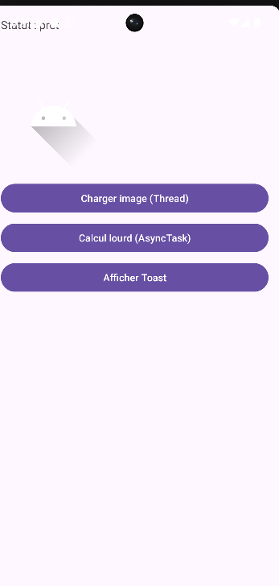
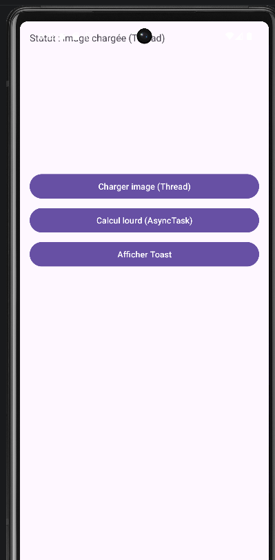
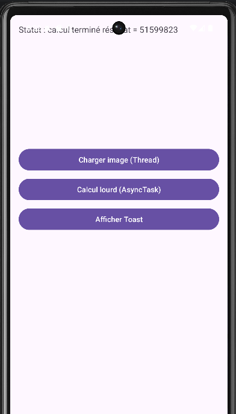
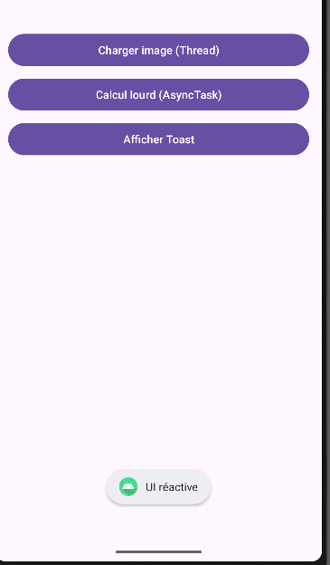

# README — Lab Android : Thread et AsyncTask

## Objectif du lab

L’objectif de ce lab est de comprendre comment exécuter des tâches longues dans une application Android sans bloquer l’interface utilisateur (UI Thread).

Pour cela, l’application utilise :

* **Thread** pour charger une image en arrière-plan
* **AsyncTask** pour effectuer un calcul lourd
* **Toast** pour vérifier que l’interface reste réactive

---

# Interface de l'application

L'application contient :

* **TextView** : affiche le statut des opérations
* **ProgressBar** : indique la progression d’une tâche
* **ImageView** : affiche une image chargée
* **3 boutons :**

1. Charger image (Thread)
2. Calcul lourd (AsyncTask)
3. Afficher Toast

---

# Lancement de l'application

Lorsque l'application démarre, l'interface affiche le statut initial et les trois boutons permettant de tester les différentes fonctionnalités.

---

# Bouton 1 — Charger image (Thread)

Lorsque l’utilisateur clique sur **Charger image (Thread)** :

1. La ProgressBar apparaît
2. Un **Thread secondaire** est lancé
3. Une pause simule un chargement
4. L’image est chargée en arrière-plan
5. L’interface est mise à jour via **Handler**

Cela évite de bloquer le **UI Thread**.

---

# Bouton 2 — Calcul lourd (AsyncTask)

Lorsque l’utilisateur clique sur **Calcul lourd (AsyncTask)** :

1. La ProgressBar devient visible
2. Un calcul long est exécuté dans **doInBackground()**
3. La progression est mise à jour avec **publishProgress()**
4. À la fin du calcul, le résultat est affiché dans le TextView

---

# Bouton 3 — Afficher Toast

Le bouton **Afficher Toast** permet de vérifier que l’interface reste réactive.

Même pendant l’exécution d’un Thread ou d’un AsyncTask, le Toast apparaît immédiatement.

Cela prouve que l’application **n’est pas bloquée**.

---

# Conclusion

Ce lab montre l’importance d’exécuter les tâches longues en arrière-plan dans une application Android.

Les concepts étudiés sont :

* utilisation de **Thread** pour exécuter une tâche en arrière-plan
* utilisation de **AsyncTask** pour gérer un traitement long avec progression
* utilisation de **Handler** pour mettre à jour l’interface
* vérification que l’interface utilisateur reste **réactive**

Ces techniques permettent d’améliorer la performance et l’expérience utilisateur dans une application Android.

